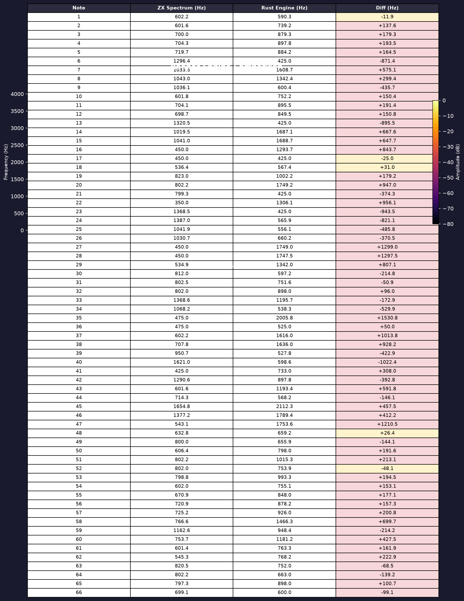

# Beepers — From Piano to Speaker Toggle

You know notes and chords from piano. This explains what's physically happening inside these beeper engines, building from what you already know.

---

## Five engines, three ideas

Before diving into each technique, here's the map. Five engines — but really only three distinct ideas:

| Engine | Idea | What it does |
|---|---|---|
| `1ch_tone.asm` | **Oscillator** | One counter, one pitch, toggle speaker at zero |
| `2ch_interleave.asm` | **Oscillator ×2** | Two counters in one loop → two pitches fighting over one speaker → chord |
| `sp83_duty_cycle.asm` | **Pulse width** | One voice, but hi-phase and lo-phase have different lengths → timbre control |
| `noise_drum.asm` | **Noise** | Random toggling instead of regular → broadband noise → percussion |
| `sweep_sfx.asm` | **Sweep** | Period shrinks each cycle → pitch rises → laser, explosion, zap |

The 2ch is not "more advanced" than sp83 — they're **orthogonal**. 2ch adds voices. sp83 shapes a single voice. A real game engine can stack both: two voices, each with its own pulse width.

---

## What's a T-state?

A T-state is one tick of the Z80's clock. The Spectrum's clock runs at 3.5 MHz, so one T-state = ~286 nanoseconds.

Every instruction takes a fixed number of T-states to execute. Simple ones like XOR take 7. Longer ones like LDIR take thousands (it loops internally).

That's why we count them — the total T-states in the loop directly determine the pitch. More T-states = longer between toggles = lower frequency.

```
One loop iteration (1ch engine):

    DEC D       4 T  ─┐
    NOP         4 T   │ 24 T total
    NOP         4 T   │ = one "tick" of the period counter
    JR NZ       12 T ─┘

The period counter counts these ticks:
    period=4:  tick tick tick tick TOGGLE → 4 × 24T = 96T per half-cycle
    period=8:  tick tick tick tick tick tick tick tick TOGGLE → 192T per half-cycle

    freq = 3,500,000 / (2 × half-cycle T-states)
    
    At 96T:  freq = 3,500,000 / 192 = 18,229 Hz (ultrasonic)
    At 192T: freq = 3,500,000 / 384 =  9,115 Hz (high whistle)
```

---

## A piano key is a frequency

When you play middle C on a piano, a hammer hits a string that vibrates 262 times per second. That's 262 Hz. A4 (the tuning note) is 440 Hz — the string vibrates 440 times per second.

Higher note = faster vibration = higher frequency. That's it. Every note is just a number.

| Note | Frequency |
|------|-----------|
| A3 | 220 Hz |
| C4 (middle C) | 262 Hz |
| D4 | 294 Hz |
| A4 (tuning) | 440 Hz |
| A5 (octave up) | 880 Hz |

An octave up = double the frequency. Always. An octave down = half.

- A3 (220 Hz) → A4 (440 Hz) → A5 (880 Hz). Each step doubles.
- Going from A4 down to A3: 440 ÷ 2 = 220. Same note, lower register.
- Going from A4 up to A5: 440 × 2 = 880. Same note, higher register.

---

## The Spectrum has no strings

The Spectrum's speaker is a tiny metal disc that can be in two positions: **pushed out** or **pulled in**. That's it. On or off. 1 or 0.

Push it out, pull it in, push it out, pull it in — 440 times per second — and you hear A4. Same frequency as the piano, completely different mechanism. The piano makes a smooth wave; the Spectrum makes a harsh square wave. That's the buzzy sound.

```
Piano (smooth sine wave):

  +1 |    **          **          **
     |  *    *      *    *      *    *
   0 |*--------*--*--------*--*--------*--→ time
     |          *              *
  -1 |           **             **


Spectrum (square wave — same frequency, different shape):

  ON |████████        ████████        ████████
     |        |       |        |       |
 OFF |        ████████         ████████
     └──────────────────────────────────────→ time
       ← one cycle →
       push out / pull in = one vibration = one Hz
```

Both produce A4. The piano sounds warm; the Spectrum sounds buzzy. The difference is the **shape** (timbre), not the **speed** (pitch).

---

## Period = how long between toggles

The beeper code doesn't think in Hz. It thinks in **how many loop iterations between each toggle**.

The CPU runs a tiny loop, over and over. Each time around takes 46 billionths of a second (46 T-states at 3.5 MHz). When a counter hits zero, it flips the speaker.

```
Small period (43) — toggles fast → high pitch:

  ON |██  ██  ██  ██  ██  ██  ██  ██  ██  ██  ██
 OFF |  ██  ██  ██  ██  ██  ██  ██  ██  ██  ██
     └───────────────────────────────────────→ time


Large period (171) — toggles slow → low pitch:

  ON |████████████████                ████████████████
 OFF |                ████████████████                ████████
     └───────────────────────────────────────→ time
```

- **Small counter (period 43)** → flips often → high pitch → A5
- **Big counter (period 86)** → flips less often → low pitch → A4
- **Bigger counter (period 171)** → flips rarely → lowest → A3
- **Double the period = half the frequency = one octave down**

The two directions are easy to mix up. Remember: Hz and period go **opposite ways**.

| Period | Hz | Note | Relationship |
|--------|-----|------|-------------|
| 43 | ~1243 | A5 | ÷2 period = ×2 Hz = octave up |
| 86 | ~621 | A4 | base |
| 171 | ~311 | A3 | ×2 period = ÷2 Hz = octave down |

That's why `period 86` and `period 43` are the same note an octave apart. Same ratio as 440 Hz and 880 Hz.

> Try it in `beeper.asm`: change `PERIOD EQU 86` to 43, then 171. You'll hear the same note jump up an octave, then down an octave.

> Try it: in `1ch_tone.asm`, change a period value and rebuild. Smaller number = higher pitch. You'll hear it immediately.

---

## Duration = how long the note plays

Each note in the table has two numbers: **(duration, period)**.

Period sets the pitch. Duration sets how long it holds — how many times the inner loop runs before moving to the next note.

```
Note table:   DEFB 3, 248      DEFB 3, 221      DEFB 6, 248
              (D4, short)      (E4, short)      (D4, held)

Speaker:  ____####____####__|__###___###___###|____####____####____####____####__
          ← dur=3, per=248 → ← dur=3, per=221→ ← dur=6, per=248 (held) ———————→
                               (faster toggle    (same pitch as first note,
                                = higher pitch)   but plays twice as long)
```

- Duration 40 = standard note
- Duration 80 = held note (twice as long)
- Duration 20 = short staccato

Same as music notation: crotchet, minim, quaver. Different encoding, same idea.

---

## The 2-channel trick: chords from one speaker

A piano plays chords by hitting multiple strings. The Spectrum has one speaker. How do you play two notes at once?

You don't — you fake it.

In `2ch_interleave.asm`, there are **two counters** (D and E) running in the same loop. Each one flips the speaker when it hits zero. They're counting down at different rates because they have different period values.

The speaker is being toggled by *both* counters, interleaved. Your ear blurs them together and hears two pitches simultaneously. It's a trick — like how a TV shows you 30 still images per second and you see motion.

### Detuned unison = chorus

When the two periods are almost the same (86 and 87), the two "channels" are slightly out of tune. They drift in and out of sync, creating a wavering **beat** — about 5 times per second. That's the hollow, shimmery Spectrum sound. Same principle as when two singers are slightly off-pitch — it sounds wider and fuller than one voice.

### Wide interval = bass + melody

When the periods are very different (43 and 171), one channel is playing a high note and the other a low note. Your ear separates them — you hear bass and melody at the same time from one speaker.

> Try it: in `2ch_interleave.asm`, find a note with periods `86, 87` and change it to `43, 171`. Same two notes, completely different sound — from chorus shimmer to bass+melody split.

### Why identical periods = silence (XOR cancellation)

When both channels have the SAME period, they hit zero at the same time. Both XOR the speaker — two flips cancel out. The speaker doesn't move.

```
Ch1 (period 86):  ____########________########________########____
Ch2 (period 86):  ____########________########________########____
                       ^toggle         ^toggle         ^toggle
XOR result:       ____________________________________________ (flat — silence)
                  Both XOR at the same instant → cancel → no sound
```

Fix: offset ch2 by +1. Now the toggles drift apart:

```
Ch1 (period 86):  ____########________########________########____
Ch2 (period 87):  _____########_________########_________########_
                       ↑               ↑ drifting apart
XOR result:       ____#________#______##________#_____###________#_
                  Toggles interleave → beating pattern → chorus shimmer
```

The beat frequency = difference between the two channels' frequencies.
At periods 86/87: beat ≈ |442 - 437| = 5 Hz (a slow wobble).

### Detuned unison — the Spectrum shimmer

```
Amplitude
  |
  |  ####    ####    ####    ####    ####    ####    ####
  | #    #  #    #  #    #  #    #  #    #  #    #  #    #
  |#      ##      ##      ##      ##      ##      ##      #
  +----------------------------------------------------------→ time
  |                    ~~~~envelope~~~~
  |              The volume swells and fades at the beat frequency.
  |              Your ear hears one pitch with a wobble — chorus.
```

Periods 86/87 → A4 at ~440 Hz with a ~5 Hz beat. This is the characteristic Spectrum sound.

### Wide interval — bass + melody

```
Ch1 (period 43 = A5):  _##__##__##__##__##__##__##__##__##__##__##__
Ch2 (period 171 = A3): _########________________########____________
                        fast toggles (high)       slow toggles (low)

XOR result:       _##__##__##__####_##__##__##__##__##__####_##__##_
                  Your ear separates these into two pitches:
                  a high note (A5) and a low note (A3)
```

### Note boundary — with and without PUSH/POP

Without PUSH/POP (exercise 1.12): A is clobbered by the duration read.
The first toggle XORs a junk value → audible click.

```
                  note 1                    note 2
Speaker:  ___####____####____####_|CLICK|##____####____####____
                                  ↑
                          A = duration byte (junk)
                          XOR 0x18 on junk → wrong state → click
```

With PUSH/POP (exercise 1.13): A is saved and restored. No click.

```
                  note 1                    note 2
Speaker:  ___####____####____####____####____####____####____
                                  ↑
                          PUSH saves A, POP restores it
                          First toggle continues smoothly
```

### Spectrogram: Manic Miner vs our engine

Our improved 2ch engine playing the same Blue Danube tune as the original Manic Miner (1983). Both use XOR interleave with two period counters — same technique, different loop speeds (56T original vs 45T ours).



---

## Duty cycle: faking volume and timbre

In `1ch_tone.asm`, each toggle spends *equal* time high and low — a 50% duty cycle. The waveform is a perfect square wave.

In `sp83_duty_cycle.asm` (from Splat!, 1983), each note frame has two separate period values:

```
NOTE_TABLE:  DEFB  hi_period, lo_period
```

Our improved version `1ch_duty.asm` adds a duration byte per note and uses a clean D major scale with deliberate duty variations — same algorithm, better for learning.

- `hi_period` — how long the speaker sits at the high state (ear+mic bits = 0x11)
- `lo_period` — how long it sits at the low state (ear bit low = 0x01)

When `hi_period == lo_period`, you get 50% duty — a plain square wave.
When `hi_period < lo_period`, the speaker is mostly low — sounds quieter and thinner.
When `hi_period > lo_period`, the speaker is mostly high — sounds louder and buzzier.

This is how a 1-bit speaker simulates volume and timbre without any DAC. It's the same trick your kettle timer uses to sound quieter: it buzzes for a short pulse rather than a long one.

> Try it: in `sp83_duty_cycle.asm`, change a frame from `DEFB 0x09, 0x13` (hi=9, lo=19) to `DEFB 0x09, 0x09` (equal) and `DEFB 0x13, 0x09` (reversed). Same pitch — different tone character.

---

## Noise: random toggling = percussion

A tone engine toggles the speaker at a *regular* rate. That regularity is what makes a pitch — your ear detects the pattern.

Break the regularity → break the pitch → you get **noise**.

In `noise_drum.asm`, instead of a counter hitting zero, a **pseudo-random number generator** (PRNG) drives the speaker. Each step produces a random bit — high or low. The speaker follows it.

The PRNG used is "el cheapo" by Shiru: `HL += DE` each step, then rotate H. Just an addition — cheap, fast, and it sounds like noise.

```
; core noise loop (simplified)
ADD  HL, DE        ; HL = HL + 0x2157 (wraps 16-bit)
RLC  H             ; mix bits
LD   A, H
AND  0x10          ; extract one "random" bit → EAR bit position
OUT  (0xFE), A     ; speaker follows the random bit
```

The **pitch delay** between outputs sets what kind of noise:
- No delay → high-frequency random → hiss, hi-hat
- Short delay → broadband crackle → snare body
- Long delay → low-frequency rumble → kick thud

There's no melody. Just chaos, deliberately applied.

> Try it: in `noise_drum.asm`, change `PITCH EQU 3` to `PITCH EQU 1` (hissier) or `PITCH EQU 12` (thuddy). Also change `BURST_LEN EQU 80` to make the hit longer or shorter.

---

## Sweep: changing pitch mid-sound

Every engine so far holds a fixed pitch for each note. What if the pitch **moves**?

In `sweep_sfx.asm`, the period counter **decrements by one every audio cycle**. Each cycle the speaker toggles a little faster than the last. The pitch rises continuously — from a low growl up to a high whine.

```
SWEEP_LOOP:
    ; HIGH phase — wait C counts
    ; LOW phase — wait C counts
    DEC  C              ; shrink period → higher pitch next cycle
    JR   NZ, SWEEP_LOOP ; until C reaches 0
```

That's a laser sound. Reverse it (INC C, stop at 0xFF) and you get an explosion — pitch falls.

The shape of the sweep depends on what you decrement:
- `DEC C` every cycle → linear sweep → steady rise
- `DEC C` twice per cycle → faster sweep → sharper attack
- Start at C=0x20 (short sweep, mid-range to treble) vs C=0xFF (long sweep, bass to treble)

> Try it: in `sweep_sfx.asm`, change `START_PERIOD EQU 0xC0` to `0x40` for a short zap. Or replace `DEC C` with `INC C` and change the loop condition to `CP 0xFF; JR NZ` for a power-down explosion.

---

## What comes next

These five engines cover the main building blocks:

- **Oscillator** → tone at a fixed pitch (`1ch_tone.asm`, `2ch_interleave.asm`)
- **Pulse width** → timbre shaping, fake volume (`sp83_duty_cycle.asm`)
- **Noise** → percussion, explosions, static (`noise_drum.asm`)
- **Sweep** → pitch movement, SFX, rising/falling tones (`sweep_sfx.asm`)

Still missing from the full acid synth picture:

- **Envelope** — how a sound changes over time (attack, decay). Beeper version: combine sweep + duration.
- **LFO** — a slow oscillator that modulates pitch (vibrato) or volume (tremolo). Beeper: nudge the period counter once per 50Hz frame.
- **Accent** — hit some notes harder. Beeper: toggle `EAR+MIC` (0x18) for loud vs `EAR` only (0x10) for quiet — a 2-level volume control.

An acid bass line needs: oscillator + pulse width + sweep (slide) + accent + LFO. You have oscillator and pulse width already. Sweep is the slide. Accent is the last hardware trick. LFO is the slowest loop.

---

## Learning objectives

### Core 4 (synth fundamentals)

- [x] **Oscillator** — a repeating waveform that makes a pitch. ✅ `1ch_tone.asm`, `2ch_interleave.asm`
- [ ] **Envelope** — how a note changes over time (attack, decay, sustain, release). Waiting for dig to find one.
- [x] **Filter** — shapes the tone by removing frequencies. Beeper version: PWM / duty cycle. ✅ `sp83_duty_cycle.asm`
- [ ] **LFO** — a slow oscillator that modulates something else. Beeper: nudge period once per 50Hz frame.

### Sound design extras

- [x] **Noise** — random toggling → percussion, static, explosions. ✅ `noise_drum.asm`
- [x] **Sweep** — period changes mid-sound → pitch movement, SFX. ✅ `sweep_sfx.asm`
- [ ] **Accent** — two volume levels per note. Beeper: EAR+MIC (loud) vs EAR only (quiet).

When all seven boxes are ticked, build an acid player.

---

## The cheat sheet

| Piano concept | Beeper equivalent |
|---------------|-------------------|
| Note pitch | Period value (smaller = higher) |
| Octave | Half/double the period |
| Note duration | Duration byte in the table |
| Chord | Two period counters in one loop — `2ch_interleave.asm` |
| Vibrato / chorus | Detuned unison (periods differ by 1) |
| Volume | Pulse width (duty cycle) — `sp83_duty_cycle.asm` |
| Drums | Random toggling (PRNG noise) — `noise_drum.asm` |
| Pitch bend / slide | Modify period mid-sound — `sweep_sfx.asm` |
| Sheet music | Note table (sequence of duration/period pairs) |
| Tempo | Loop speed (fixed by T-states — change duration instead) |

---

## Further reading

- [ZX Spectrum 1-Bit Routines](https://github.com/utz82/ZX-Spectrum-1-Bit-Routines) — utz82's collection of production-quality beeper engines. PhaserF, nanobeep, click drums, vibrato. Good for seeing how far the techniques scale.
- [Shiru's 1tracker](https://github.com/bushy555/1tracker-by-Shiru) — tracker tool using Shiru's beeper engines. The PRNG in `noise_drum.asm` is Shiru's "el cheapo" algorithm.
- [Spectrum Computing beeper forum](https://spectrumcomputing.co.uk/forums/viewtopic.php?p=136895) — discussion of modern engines (Ulasyn, PhaserF).
- [How to Write a 1-Bit Music Routine](http://randomflux.info/1bit/viewtopic.php?id=21) — utz's definitive 12-part tutorial. Covers PFM, pulse interleaving, drums, pulse width, PCM, noise, phasing, SID, duty modulation, waveform synthesis. Start here for anything beyond Engine 3.
- [Digital Audio on the ZX Spectrum's 1-Bit Beeper](https://bumbershootsoft.wordpress.com/2026/09/26/digital-audio-on-the-zx-spectrums-1-bit-beeper/) — Bumbershoot's 2026 writeup on PWM sample playback. Shows how a 1-bit output fakes multi-bit resolution via pulse-width encoding.

---

## Envelope: how a note dies

Every acoustic instrument has a characteristic shape to how its sound starts and stops. A piano note starts loud (the hammer strikes) and fades over seconds. A drum is a sharp spike that dies in milliseconds. A flute is a slow rise, steady hold, slow fade.

Synthesisers model this with **ADSR**: Attack, Decay, Sustain, Release. Four stages of a note's life.

On a beeper, we don't have amplitude control — but we have period control. And period affects perceived loudness through a hack: at very high periods the speaker toggles so slowly that each impulse is separate — it sounds quieter and "dying."

The simplest envelope: **pitch decay**. After each outer loop pass, add 1 to the period. The pitch drops a tiny bit each cycle. The effect sounds like a plucked string or a bell — a note that dies away.

```
; decay: period increases each cycle → pitch drops → sounds like it fades
PLAY_DECAYING_NOTE:
    LD B, period
    LD D, 200           ; duration
.outer:
    ; ... inner toggle loop (same as 1ch) ...
    INC B                ; period grows → pitch drops → "fading"
    DEC D
    JR NZ, .outer
```

Reverse the direction (DEC B) and you get an attack transient — the pitch rises into the note like a synth pad.

Combine attack + decay: DEC B for a few cycles (rising), then INC B for many cycles (falling). That's an ADSR in two lines of Z80.

---

## LFO and vibrato: slow wobble

An LFO (Low Frequency Oscillator) is a slow repeating pattern that modulates something else. When it modulates pitch, you hear **vibrato** — the note wobbles up and down around its centre.

On a beeper, vibrato is: alternate between adding and subtracting a small amount from the period counter every N toggles.

```
; vibrato: period oscillates between (base-depth) and (base+depth)
LD B, period
LD C, lfo_speed       ; how many toggles between direction changes
LD E, depth           ; how much to wobble

.lfo_up:
    ; inner toggle loop for C toggles...
    ADD A, E            ; period increases (pitch drops)
    LD B, A
    DEC C
    JR NZ, .lfo_up
    LD C, lfo_speed

.lfo_down:
    ; inner toggle loop for C toggles...
    SUB E               ; period decreases (pitch rises)
    LD B, A
    DEC C
    JR NZ, .lfo_down
    ; ... repeat
```

- **Slow LFO** (speed=50, depth=2): gentle classical vibrato
- **Fast LFO** (speed=5, depth=1): tight machine tremolo
- **Deep LFO** (speed=20, depth=8): seasick warble — usually too much

Vibrato on one channel of the 2ch engine with the other channel steady creates a lead-over-drone texture.

---

## Accent: two volume levels

The Spectrum port $FE has two speaker-affecting bits:
- Bit 4 (EAR) — the main speaker driver
- Bit 3 (MIC) — the cassette output, but it also feeds the speaker

Writing both bits (`XOR $18`) drives the speaker harder — louder. Writing only bit 4 (`XOR $10`) is quieter.

That gives you **two volume levels** — enough for rhythmic accent. Mark some notes as "loud" and others as "soft":

```
; loud note: XOR $18 (both EAR + MIC)
; soft note: XOR $10 (EAR only)
```

In the note table, add an accent byte: 0 = soft, 1 = loud. The toggle loop reads it and uses $18 or $10 accordingly.

This is how games put emphasis on beat 1 of a bar, or make alternating notes swing. Same pitch, different punch.

---

## Tone + noise mixing: gritty bass and drum patterns

Engines 1-3 treat tone and noise as separate things. But real instruments aren't purely tonal or purely noisy — a snare drum has both a tonal body and a noise burst. A distorted bass guitar is a pitched tone with broadband noise mixed in.

On the beeper, mix them by alternating: every Nth toggle, replace the period counter with a PRNG output instead.

```
; mix loop: mostly tone, occasional noise
.mix_loop:
    DEC D                ; period counter
    JR NZ, .no_toggle
    LD D, period         ; reload
    ; every Nth cycle, inject noise instead of toggling regularly
    DEC C
    JR NZ, .normal_toggle
    LD C, mix_ratio      ; reload
    ADD HL, DE           ; PRNG step
    RLC H
    LD A, H
    AND $10              ; noise bit
    JR .output
.normal_toggle:
    XOR $10              ; regular toggle
.output:
    OUT ($FE), A
```

- **mix_ratio = 2**: every other sample is noise. Gritty, distorted bass.
- **mix_ratio = 8**: mostly clean tone with a grainy texture. Warm.
- **mix_ratio = 1**: pure noise (same as noise_drum).

For drum patterns with melody: the note table includes a "mode" byte. Mode 0 = tone. Mode 1 = noise burst. The player loop checks the mode and switches between tone and noise engines per note. One loop, both sounds.

---

## Digital audio: PWM and sample playback

Everything so far generates sound algorithmically — a loop toggles the speaker at computed intervals. But what if you have a *recording* — actual audio samples — and want to play them back?

### 1-bit PCM: the simplest approach

Store the audio as a stream of 1s and 0s. Output each to the speaker with a constant delay between samples:

```
.pcm_loop:
    LD A, (HL)           ; load sample byte (0 or 1)
    OUT ($FE), A          ; output to speaker
    INC HL
    ; delay loop for sample rate
    LD B, delay
.wait:
    DJNZ .wait
    ; check for end of sample
    ...
```

At 8 kHz, one second of audio needs 8000 bytes of RAM — a quarter of the 48K Spectrum. Quality is harsh (like a telephone underwater) but recognisable.

### PWM: faking multi-bit resolution

The speaker is still 1-bit (on or off). But if you turn it ON for 3 out of 16 clock cycles, the speaker cone sits at ~19% of its travel. Turn it on for 12 out of 16 and it sits at ~75%. Varying this fraction gives you **multi-bit amplitude from a 1-bit output**.

This is Pulse Width Modulation (PWM):

```
; sample value in A (0-15), play one PWM cycle
; total time = 16 counts (constant)
    LD B, A              ; B = on-time
    LD A, $10
    OUT ($FE), A          ; speaker ON
.on_wait:
    DJNZ .on_wait         ; wait B counts
    
    LD B, 16
    SUB C                 ; B = 16 - on-time = off-time
    XOR A
    OUT ($FE), A          ; speaker OFF
.off_wait:
    DJNZ .off_wait        ; wait remaining counts
```

The critical constraint: ON+OFF must always sum to the same total. If they don't, you hear a pitch artefact (the varying total period IS a frequency).

4-bit PWM (16 levels) at 3.5 MHz gives ~4.4 kHz sample rate with a 16-count cycle. Quality is dramatically better than 1-bit PCM — recognisable speech and drum hits.

### Capturing output to a buffer

Instead of just sending sound to the speaker, you can simultaneously write it to RAM — creating a "recording" of what the beeper played:

```
; inside the tone engine's inner loop, after OUT:
    LD (IX), A            ; store speaker state in buffer
    INC IX                ; advance buffer pointer
```

After playback, the buffer at $A000 contains a waveform trace. You can visualise it by printing `*` for 1 and `.` for 0 — a primitive oscilloscope on screen.

This is useful for debugging: if the waveform looks wrong (too fast, no toggling, stuck high), you can see it without hearing it. It's also the basis for beeper-to-WAV export tools.

> Reference: [Bumbershoot's Digital Audio on the ZX Spectrum](https://bumbershootsoft.wordpress.com/2026/09/26/digital-audio-on-the-zx-spectrums-1-bit-beeper/) goes deep on PWM sample playback with hardware verification.

---

## Learning objectives

### Core 4 (synth fundamentals)

- [x] **Oscillator** — a repeating waveform that makes a pitch. ✅ `1ch_tone.asm`, `2ch_interleave.asm`
- [ ] **Envelope** — how a note changes over time (attack, decay, sustain, release). → Engine 4 (4.1-4.3)
- [x] **Filter** — shapes the tone by removing frequencies. Beeper version: PWM / duty cycle. ✅ `sp83_duty_cycle.asm`
- [ ] **LFO** — a slow oscillator that modulates something else. Beeper: nudge period once per 50Hz frame. → Engine 4 (4.4-4.7)

### Sound design extras

- [x] **Noise** — random toggling → percussion, static, explosions. ✅ `noise_drum.asm`
- [x] **Sweep** — period changes mid-sound → pitch movement, SFX. ✅ `sweep_sfx.asm`
- [ ] **Accent** — two volume levels per note. Beeper: EAR+MIC (loud) vs EAR only (quiet). → Engine 4 (4.8-4.10)
- [ ] **Tone+Noise Mix** — pitched tone with noise texture → gritty bass, drum patterns. → Engine 4 (4.11-4.14)

### Digital audio

- [ ] **1-bit PCM** — raw sample playback at fixed rate. → Engine 5 (5.1-5.3)
- [ ] **PWM playback** — multi-bit amplitude from 1-bit output. → Engine 5 (5.4-5.7, 5.12-5.15)
- [ ] **Output capture** — buffer beeper state to RAM for waveform visualisation. → Engine 5 (5.8-5.11)

When all boxes are ticked, build an acid player — and maybe play back a drum sample over it.

---

## The cheat sheet

| Piano concept | Beeper equivalent |
|---------------|-------------------|
| Note pitch | Period value (smaller = higher) |
| Octave | Half/double the period |
| Note duration | Duration byte in the table |
| Chord | Two period counters in one loop — `2ch_interleave.asm` |
| Vibrato / chorus | Detuned unison (periods differ by 1) |
| Volume | Pulse width (duty cycle) — `sp83_duty_cycle.asm` |
| Drums | Random toggling (PRNG noise) — `noise_drum.asm` |
| Pitch bend / slide | Modify period mid-sound — `sweep_sfx.asm` |
| Sheet music | Note table (sequence of duration/period pairs) |
| Tempo | Loop speed (fixed by T-states — change duration instead) |
| Fade out | Pitch decay — increment period each cycle (Engine 4) |
| Vibrato | LFO — alternate add/sub on period counter (Engine 4) |
| Accent | EAR+MIC ($18) loud vs EAR ($10) quiet (Engine 4) |
| Distorted bass | Tone+noise mix — alternate PRNG and period counter (Engine 4) |
| Drum sample | 1-bit PCM or 4-bit PWM playback from RAM (Engine 5) |
| Recording | Buffer speaker state to RAM — oscilloscope trace (Engine 5) |

---

## Bit-banging vs sound chips: you ARE the oscillator

There are two fundamentally different ways a computer makes sound.

### Bit-banging (48K Spectrum beeper)

There is no sound hardware. There is a single wire connected to a speaker, and one bit in a port register that controls it. High or low. On or off.

Your code IS the oscillator. Every toggle, every delay, every pitch calculation — that's your CPU doing the work, instruction by instruction. Miss a timing window and the pitch wobbles. Take an interrupt and you hear a click.

```
; you are the oscillator
loop:
    XOR 0x10            ; flip the speaker
    OUT (0xFE), A       ; push it out
    ; ... wait ...      ; you control the timing
    JR loop             ; you do it again
```

This is **bit-banging** — directly manipulating hardware pins from software in a tight loop. The CPU can't do anything else while it's making sound. No game logic, no screen updates, nothing. Sound owns the machine.

That's why `DI` (disable interrupts) is the first instruction in every beeper engine. Even the Spectrum's 50Hz system tick would inject enough jitter to hear.

### Sound chip (128K Spectrum AY-3-8912)

The 128K Spectrum has a dedicated sound chip: the AY-3-8912. Three independent tone channels, a noise generator, hardware envelopes, and a mixer — all running autonomously.

You don't toggle anything. You write configuration to registers and the chip makes the sound:

```
; you configure the oscillator — the chip does the rest
    LD A, 0             ; select register 0 (channel A period, low byte)
    OUT (0xFD), A
    LD A, 86            ; set the period
    OUT (0xFF), A       ; chip generates the tone from here
    ; ... CPU is free to do other things ...
```

Set it and forget it. The AY chip toggles its own output at the period you specified. Your CPU is free to run game logic, update the screen, read input — sound happens in the background.

### What's the difference in sound?

| | Beeper (bit-bang) | AY chip |
|---|---|---|
| **Channels** | 1 speaker, fake multi-channel via interleave | 3 real hardware channels + noise |
| **Volume** | 1-bit: on or off. Fake it with duty cycle. | 16 levels per channel |
| **Envelope** | Manual: INC/DEC period in your loop | Hardware ADSR — set shape, chip runs it |
| **CPU cost** | 100% — CPU IS the sound | ~0% — chip runs independently |
| **Timbre** | Harsh square wave. Raw, buzzy, iconic. | Cleaner, rounder. Classic chiptune sound. |
| **Character** | Scrappy, lo-fi, every cycle counts | Polished, three voices singing together |

### Why learn beeper if AY exists?

Because beeper teaches you how sound actually works. AY abstracts it — you set a period register and sound comes out. Beeper makes you build it from nothing: what is a frequency, what is a duty cycle, why does noise sound like noise, how does an envelope die.

Everything you learn from beeper engines transfers directly to the Rust VSTi. The AY chip's internal logic is just hardware doing what your beeper code does in software — oscillator, noise generator, envelope shaper, mixer.

### For the VSTi

Both approaches end up as the same thing in Rust: oscillator functions that generate samples. The beeper version is closer to what you'll actually write — a function that toggles state, counts periods, and outputs samples. The AY version is how a synth plugin user thinks — set parameters, sound happens.

Your VSTi will bridge both: beeper-style engines under the hood, AY-style parameter control on top.

---

## From beeper engines to chip music

Chip music isn't a different kind of synthesis. It's a **player** — a scheduler that reads structured data and dispatches to engines you've already built.

### What a tracker does

A tracker is a grid. Rows are time (top to bottom). Columns are channels (left to right). Each cell says "play this note with this instrument and these effects."

```
Row  Ch1         Ch2         Ch3
00   C-4 01 ...  --- -- ...  --- -- ...
01   --- -- ...  E-4 02 ...  --- -- ...
02   D-4 01 V80  --- -- ...  G-2 03 ...
03   --- -- ...  --- -- S03  --- -- ...
```

At ~50Hz (one row per frame), the player reads each row and sets engine parameters:
- **Note** → sets the period counter (Engine 1)
- **Instrument** → selects duty cycle, envelope shape, noise mix (Engines 2, 4)
- **Effect** → applies vibrato, slide, arpeggio (Engines 3, 4)

Then the engine runs for one frame and the player advances to the next row.

### Instruments are just parameter sequences

An "instrument" in a tracker is a list of per-frame settings:

```
Frame 0: duty 50%, volume loud     ← attack
Frame 1: duty 40%, volume loud
Frame 2: duty 30%, volume quiet    ← decay
Frame 3: duty 25%, volume quiet    ← sustain
...
```

That's your Engine 4 envelope + Engine 2 duty cycle, driven by a table instead of hardcoded INC/DEC.

### Song structure is just a playlist

A song is a list of pattern numbers:

```
Order: [0, 1, 0, 1, 2, 0, 1, 0, 1, 2, 3]
         intro  verse    chorus  verse    chorus  outro
```

The player walks through the order list, plays each pattern, moves to the next. Loop points make it repeat. That's it — no new synthesis, just data organisation.

### The same data works everywhere

The tone table format you're building in the exercises works in both Z80 and Rust. A tracker just adds structure around it:

```
Z80:   LD IY, pattern_data    ; point at the pattern
       ... read row, set engines, run frame ...

Rust:  let row = &pattern[current_row];
       engine.set_period(row.note);
       engine.set_duty(row.instrument.duty);
       engine.process_frame(&mut output);
```

Same data, same sound.

---

## The bridge: sound chips → MIDI → DAWs

The jump from 1980s sound chips to modern music production isn't a leap — it's the same ideas with more knobs.

### Register writes are MIDI messages

When you write to an AY register, you're saying "channel A, set period to 86." When a DAW sends a MIDI message, it's saying "channel 1, note on, pitch A4, velocity 100." Same instruction, different protocol.

| 1980s sound chip | Modern DAW / MIDI | What it does |
|---|---|---|
| `OUT (0xFD), period` — write period register | MIDI Note On (note number) | Start playing this pitch |
| Volume register (0–15) | MIDI velocity (0–127) | How loud |
| Envelope shape register | Synth ADSR knobs / preset | How the note evolves over time |
| Noise enable bit | Oscillator type selector | Tone vs noise source |
| 3 AY channels | 16 MIDI channels | Independent voices |
| Duty cycle register | Pulse width knob on a synth | Timbre / tone shape |
| Pattern row in a tracker | Note in a piano roll | What plays when |
| Instrument definition table | Synth patch / preset | Complete sound recipe |
| Song order list | DAW arrangement view | Which section plays next |

### The signal flow is identical

```
1980s:
  Tracker row → write AY registers → chip makes sound

Modern:
  Piano roll → send MIDI → synth plugin makes sound

Your VSTi:
  Piano roll → receive MIDI → translate to period/duty/envelope → beeper engine makes sound
```

The middle step changed (register writes → MIDI protocol). The concept didn't.

### What MIDI added

MIDI is just a standard so different gear speaks the same language. The AY chip had its own register layout. The SID chip (Commodore 64) had a different one. The OPL (AdLib/Sound Blaster) had yet another. Every chip was its own dialect.

MIDI said: one protocol for all of them. Note on, note off, pitch, velocity, control change, program change. Any synth that speaks MIDI can be driven by any sequencer. That's why you can swap plugins in a DAW and the arrangement still works — the notes are the same, the sound engine is different.

Your beeper engines are sound engines. MIDI is how the DAW talks to them. The VSTi is the translator between the two.

### Why this matters for the VSTi

The VSTi receives MIDI and needs to map it to engine parameters:

| MIDI event | Engine action |
|---|---|
| Note On (pitch, velocity) | Set period from note number, set accent from velocity |
| Note Off | Start release phase of envelope (or silence) |
| Control Change: modwheel | Set vibrato depth (Engine 4 LFO) |
| Control Change: filter cutoff | Set duty cycle ratio (Engine 2 pulse width) |
| Pitch bend | Continuous period change (Engine 3 sweep) |
| Program change | Switch instrument (different envelope + duty + noise mix) |

Every MIDI control maps to something you've already built as a beeper engine. The protocol is modern, the synthesis is 1982.

---

## Further reading

- [ZX Spectrum 1-Bit Routines](https://github.com/utz82/ZX-Spectrum-1-Bit-Routines) — utz82's collection of production-quality beeper engines. PhaserF, nanobeep, click drums, vibrato. Good for seeing how far the techniques scale.
- [Shiru's 1tracker](https://github.com/bushy555/1tracker-by-Shiru) — tracker tool using Shiru's beeper engines. The PRNG in `noise_drum.asm` is Shiru's "el cheapo" algorithm.
- [Spectrum Computing beeper forum](https://spectrumcomputing.co.uk/forums/viewtopic.php?p=136895) — discussion of modern engines (Ulasyn, PhaserF).
- [How to Write a 1-Bit Music Routine](http://randomflux.info/1bit/viewtopic.php?id=21) — utz's definitive 12-part tutorial. Covers PFM, pulse interleaving, drums, pulse width, PCM, noise, phasing, SID, duty modulation, waveform synthesis. Start here for anything beyond Engine 3.
- [Digital Audio on the ZX Spectrum's 1-Bit Beeper](https://bumbershootsoft.wordpress.com/2026/09/26/digital-audio-on-the-zx-spectrums-1-bit-beeper/) — Bumbershoot's 2026 writeup on PWM sample playback. Shows how a 1-bit output fakes multi-bit resolution via pulse-width encoding.
