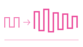

<!-- _class: title-slide -->
<!-- _paginate: false -->



# Bloom

**Chiptune to full production via GAN domain translation**

Take a 1-bit beeper track and blow it up to a modern multi-track arrangement.

---

## What this will be

Audio domain translation using spectrogram-based GANs. Treat spectrograms as images and learn to map from the chiptune domain to the full-production domain — the audio equivalent of pixel art to photorealistic rendering.

| Component | Detail |
|-----------|--------|
| **Architecture** | CycleGAN (unpaired) / pix2pix (paired) |
| **Input domain** | Chiptune spectrograms from Beepers |
| **Output domain** | Modern production spectrograms |
| **Training** | Generator/discriminator adversarial loop |
| **Goal** | Preserve melody and rhythm, transform timbre and richness |

---

## What is a GAN?

A Generative Adversarial Network trains two networks against each other:

- **Generator** — creates fake images (spectrograms) trying to fool the discriminator
- **Discriminator** — tries to tell real from fake

They improve together: the generator gets better at faking, the discriminator gets better at detecting. When training converges, the generator produces outputs indistinguishable from real data.

**CycleGAN** extends this to unpaired domain translation — no matching pairs needed. It learns two mappings simultaneously (chiptune → production AND production → chiptune) and enforces cycle consistency: translating back and forth should return to the original.

---

## How it works

Beeper track in. Production track out. Same melody, richer sound.

```
Beepers WAV → spectrogram → CycleGAN generator → production spectrogram → WAV
  1-bit           A                G(A→B)                  B
  square wave                                         full arrangement
```

- **Spectrogram as image** — the same representation Signal Hunt and Drift use
- **Domain A** — chiptune: simple waveforms, limited harmonics, 1-4 channels
- **Domain B** — production: complex timbres, rich harmonics, full mix
- **Cycle consistency** — G(A→B) → G(B→A) ≈ A, ensuring structure is preserved

---

## How it connects

Four related projects exploring sound from different angles.

```
Beepers              Signal Hunt           Chant                 Drift
───────              ───────────           ─────                 ─────
Build the signals    Classify them         Describe → generate   Generate from noise

                              Bloom
                              ─────
                     Transform them — chiptune → production
```

- **Beepers** generates the source material — 1-bit chiptune audio from first principles
- **Signal Hunt** verifies the output — does it still classify as the same notes/chords?
- **Drift** shares the spectrogram pipeline and noise understanding
- **Chant** provides text-conditioned input — "bloom this arpeggio into a string section"

---

## The audio-to-finance bridge

GAN domain translation maps directly to financial data challenges.

| Bloom concept | Financial application |
|---------------|---------------------|
| CycleGAN unpaired translation | Model trained on one market adapted to another (same technique, different domains) |
| Synthetic data generation | GANs producing realistic transaction tables for testing and compliance (CTGAN) |
| Style transfer | Transform low-resolution data into enriched synthetic datasets |
| Adversarial training | Stress testing — generate realistic extreme scenarios that haven't occurred historically |
| Domain preservation | Maintain statistical properties while changing the surface characteristics |

Learn it on audio where you can hear the transformation. Apply it to data where you need synthetic realism.

---

## Status

This project is in the planning phase.

| Done | What |
|------|------|
| ✓ | Architecture research (CycleGAN, pix2pix) |
| ✓ | Connection to Beepers as source material |
| | Dataset collection — paired and unpaired spectrogram sets |
| | CycleGAN training on chiptune ↔ production |
| | Evaluation — does the melody survive translation? |
| | Demo — beeper track in, production track out |

*The hard part isn't the neural network. It's defining what "production quality" means well enough for a machine to learn the difference.*
