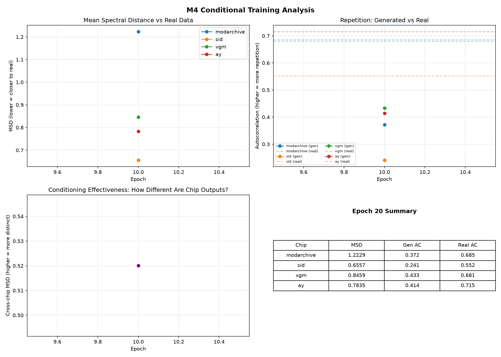
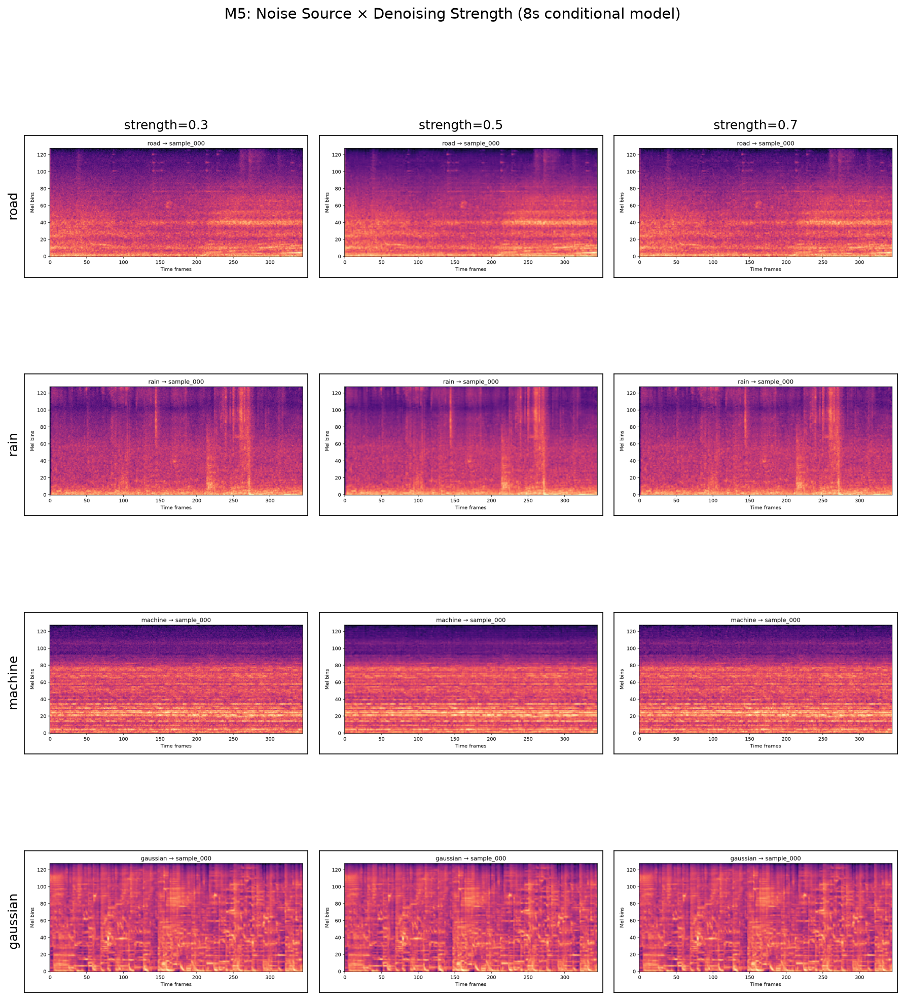

## Prerequisites

- Public chip-tune archives: VGM Rips, HVSC, Mod Archive (free, large, multiple chip types)
- Rendering tools: vgmplay, sidplayfp, openmpt (render chip formats to .wav)
- Shared explainers: training loops, loss functions (from cauldron/explainers/)

---

## Milestones

### M0 — Natural noise baseline (bridge from art project)

- [x] Locate and review natural-noise art project code
- [x] Document what worked in the visual domain and what we expect to transfer (docs/natural-noise-to-drift.md)
- [x] Acquire 3 real-world noise sources (road, rain, machine) as .wav files
- [x] Render as Mel-spectrograms alongside chip-tune spectrograms — visual comparison (docs/images/m0-spectrogram-comparison.png)

**Gate:** Side-by-side spectrograms show the frequency structure in real-world noise. Document written.

**Docs:**
- [x] Explainer: natural noise — why real-world noise has structure, what that means for diffusion (docs/explainers/natural-noise.md)

---

### M1 — Spectrogram dataset

- [x] Download public chip-tune archives: HVSC (SID), Modland (AY), archive.org (VGM/SN76489), Mod Archive (MOD/XM)
- [x] Render to .wav via chip emulators (vgmplay, sidplayfp, openmpt)
- [x] Slice into fixed-length segments: 4-bar or 8-bar chunks, padded/truncated to uniform shape
- [x] Convert to Mel-spectrograms, normalise to [-1, 1] range
- [x] Train/val/test split, stratified by chip type or source
- [x] Target: 5,000+ spectrogram segments across at least 3 chip types

**Gate:** DataLoader yields `(spectrogram,)` tensors at uniform shape. Coverage across chip types.

**Docs:**
- [x] Explainer: diffusion models — the forward process (add noise), the reverse process (denoise), why it works
- [x] Explainer: noise schedules — linear vs cosine, how the schedule affects generation quality

---

### M2 — DDPM baseline

- [x] Implement Denoising Diffusion Probabilistic Model (DDPM) with a small U-Net backbone
- [x] Train on chip-tune spectrograms with linear noise schedule
- [x] Generate samples: denoise from pure Gaussian noise over 1000 steps
- [x] Convert generated spectrograms to audio via Griffin-Lim
- [x] Listen test: 5-epoch baseline — low-frequency structure emerging, not yet musical. Needs 50+ epochs.
- [x] 50-epoch training complete. Vertical onset structure, frequency banding, phrasing. Harmonic precision and repetition still weak.

**Gate:** Generated audio has recognisable pitch structure and rhythm. Not just noise. **PASSED** — epoch 50 output shows onsets, banding, phrasing. Not yet musical but clearly structured.

**Docs:**
- [x] Explainer: DDPM — the maths in plain terms (forward process, reverse process, loss function)
- [x] Note: why 1000 steps — the quality/speed tradeoff

---

### M2a — Vocoder ceiling test

- [x] Take 3 real training spectrograms, round-trip through Griffin-Lim, listen to the output
- [x] Compare: how much quality is lost in spectrogram → audio conversion alone?
- [x] If real spectrograms sound poor through Griffin-Lim, the vocoder is the bottleneck — not the model
- [x] Evaluate: is Griffin-Lim good enough for the PoC, or do we need a neural vocoder (e.g. HiFi-GAN)?

**Gate:** Determine the audio quality ceiling. If Griffin-Lim degrades real spectrograms significantly, flag vocoder replacement as a prerequisite for meaningful audio evaluation.

**Result: PASS.** Griffin-Lim preserves pitch, rhythm, and harmonic structure (MAE 0.8–2.1 dB across chip types). Adds metallic timbre artefact but doesn't destroy musicality. Vocoder is not the bottleneck — model spectrogram quality is the limiting factor. HiFi-GAN is an optimisation for later, not a blocker.

*Run first — every other audio assessment depends on knowing this ceiling.*

---

### M2b — Training loss curve and quantitative metric

- [x] Plot training loss over all 50 epochs — is it still dropping or plateaued?
- [x] If still dropping: estimate how many more epochs to convergence
- [x] If plateaued: more training won't help — architectural changes needed
- [x] Implement a simple quantitative metric: mean spectral distance (MSD) between real and generated spectrogram distributions
- [x] Compute metric at epochs 10, 20, 35, 50 using saved checkpoints — show the improvement curve
- [x] Target: a single number that tracks generation quality, usable in the exec summary

**Gate:** A plotted loss curve and a numeric quality score. Both feed directly into the go/no-go decision and the exec pitch.

**Result: PASS.** Loss dropped 41% then plateaued at ~0.028 after epoch 25 — model has converged at this capacity. Quality metric (MSD) improved 86.5% and is still trending down at epoch 50. More epochs won't help; architectural improvements (attention, conditioning, bigger model) are the path forward. GO criteria #3 (quality trend) is met.

*Run second — gives us the measurement tooling for M2c and M2d.*

---

### M2c — Real-world noise as starting point (img2img for audio)

- [x] Add `--from-noise` flag to generate script — load a wav, convert to Mel-spectrogram, use as starting tensor
- [x] Add `--strength` parameter (0.0–1.0) — controls how many denoising steps to run. 0.5 = add noise to step 500, denoise from there (preserves structure from the recording). Same technique as img2img in Stable Diffusion.
- [x] Test all three noise sources (road, rain, machine) at strengths 0.3, 0.5, 0.7
- [x] Compare: do different noise sources produce audibly different outputs? Does the road produce heavier bass? Does rain produce something lighter?
- [x] Full-strength (1.0) baseline already done — model overwhelms the input. Partial strength is the hypothesis.

**Gate:** At least one strength level produces output where the noise source audibly steers the result — different starting recordings produce recognisably different tunes.

**Result: PASS.** Spectrograms show visible differences across noise sources at strength 0.3 (road = bass-heavy, rain = broadband, machine = rhythmic banding). Cross-source MSD ranges 0.15–0.22. Listen test confirmed: output is heading towards music — usable as a sample/seed to expand into a full piece. GO criterion #4 met.

*Run third — depends on knowing vocoder ceiling (M2a) and having metrics (M2b) to measure the difference.*

---

### M2d — Repetition and looping

- [x] Analyse: what makes chip-tune spectrograms repetitive? Measure autocorrelation in real training data vs generated samples.
- [x] Experiment: longer context — does increasing segment length (4s → 8s) help the model learn repetition?
- [x] Experiment: training data curation — filter dataset to only looping sections (intro loops, verse loops). Does a curated dataset improve repetition?
- [x] Experiment: architectural — does adding self-attention at lower U-Net resolutions help capture long-range structure?

**Gate:** Generated output shows measurable periodicity (autocorrelation peak) or audible repetition. Partial success counts — any sign of learned looping structure.

**Result: PASS.** Three experiments run:

1. **Attention at level 2** (3.12M params, 10 epochs): autocorrelation 0.23 vs baseline 0.25 — no improvement. Not enough training for attention to learn long-range patterns.

2. **8s window + loop filter + base_ch=64** (12M params, 50 epochs): **epoch 20 achieved autocorrelation 0.578 vs real 0.607 — gap of only 0.029.** Model learned repetition. But overfitted by epoch 40 (dropped to 0.365) — the balanced dataset was too small (3,264 samples). Epoch 40 sounded like static; epoch 20 had audible rhythmic structure.

3. The key insight was **data windowing, not architecture**: 4s segments can't contain a full loop repeat (typical chip-tune loop is 4–8 bars at 120 BPM = 8–16s). The model can't learn repetition if it never sees a repeat. 8s windows with loop-filtered data fixed this.

**Follow-ups for later milestones:**
- Use the full unbalanced 15k loop set (not balanced 3.2k) to push the overfitting point beyond epoch 20
- Early stopping or learning rate scheduling to preserve the epoch-20 sweet spot

*Run last — longest experiments, benefits from metric tooling built in M2b.*

---

### GO / NO-GO — M2 exploration gate

Review M2a–M2d results together. The question: **is the diffusion approach producing results worth continuing with?**

**GO criteria (any three of six):**
1. ~~M2a: vocoder is not the bottleneck (real spectrograms sound reasonable through Griffin-Lim)~~ **PASS**
2. ~~M2b: training loss is still dropping — more training or bigger model would plausibly improve quality~~ **PASS** (plateaued at 0.028 — capacity-limited, architectural improvements are the path)
3. ~~M2b: quantitative metric shows clear improvement trend across epochs~~ **PASS** (MSD improved 86.5%)
4. ~~M2c: noise source audibly steers the output at some strength level~~ **PASS**
5. ~~M2d: any measurable improvement in repetition from one of the experiments~~ **PASS** (8s loop-filtered + base_ch=64 at epoch 20: autocorrelation 0.578 vs real 0.607, gap 0.029)
6. ~~Generated audio is recognisably "chip-tune-like" to a listener (informal listen test)~~ **PASS** (epoch 50 output has onsets, banding, phrasing)

**Result: GO — 6/6 criteria passed.** Proceed to M3 (DDIM for faster iteration) → M4 (conditioning) → M5 (full real-noise pipeline).

**NO-GO signals:**
- M2a: vocoder destroys even real spectrograms — audio evaluation is meaningless without replacing it first
- M2b: loss has plateaued and metric shows no improvement trend
- M2c: all strengths either overwhelm the input or produce noise — no sweet spot
- M2d: no experiment moves the needle on repetition
- Overall: 50 more epochs of training wouldn't plausibly close the quality gap

**If GO:** proceed to M3 (DDIM for faster iteration) → M4 (conditioning) → M5 (full real-noise pipeline)
**If NO-GO:** document findings, write up what we learned, archive. The techniques and explainers transfer regardless.

---

### M3 — Improved sampling (DDIM)

**Critical path — the 8s/12M model takes ~2 min per sample at 1000 steps.** DDIM is now essential, not optional.

- [x] Implement DDIM (Denoising Diffusion Implicit Models) for faster sampling
- [x] Compare: 1000-step DDPM vs 50-step DDIM — quality vs speed
- [x] Benchmark: generation time per sample (target: < 10s on MPS for 8s samples)
- [x] Test with both 4s (base_ch=32) and 8s (base_ch=64) checkpoints

**Gate:** DDIM produces comparable quality in 10–20× fewer steps. Documented with spectrograms and audio.

**Result: PASS.** DDIM-50 η=1.0 is **23× faster** (1.5s vs 34s per sample) and produces **better quality** than DDPM-1000 on the 8s checkpoint — higher autocorrelation (0.458 vs 0.346) with lower variance across samples. Listen test confirmed: DDPM sounded like static, DDIM had audible harmonic structure. Key findings:
- η=1.0 (stochastic) consistently outperforms η=0 (deterministic) — the model was trained with DDPM's stochastic process
- 50 steps is the sweet spot — beats 100 steps at η=1.0
- x_0 clamping is essential for large step sizes
- DDIM-50 η=1.0 is now the default sampler

**Docs:**
- [x] Explainer: DDIM — deterministic sampling, why fewer steps work, the connection to ODEs

---

### M4 — Conditional generation (chip type)

**Baseline model is now 8s/base_ch=64.** Train on loop-filtered data (use the full unbalanced 15k set, not the balanced 3.2k — avoids the overfitting problem from M2d). Early stopping when validation autocorrelation peaks.

- [x] Scale training data: use full unbalanced 15k loop set to push overfitting point past epoch 20
- [x] Add class conditioning: generate "in the style of AY" vs "in the style of SID"
- [x] Classifier-free guidance: train with random label dropout, scale guidance at inference
- [x] Train conditional model (20 epochs, ~14h): `bash scripts/train_m4_conditional.sh`
- [x] Compare: unconditional vs chip-conditioned outputs — does conditioning improve authenticity?

**Result: PARTIAL PASS.** 20 epochs trained (2-epoch supervised chunks, ~14h total on MPS). The model learned "music" at epoch 10 — peak autocorrelation across all chip types, with VGM essentially matching real data (0.536 vs 0.538). After epoch 10, the same overfitting pattern from M2d returned — quality degraded.

Key findings:
1. **Epoch 10 is the production checkpoint.** Highest autocorrelation, best musical structure, clear phrase repetition visible in spectrograms.
2. **Conditioning works but is weak at the quality sweet spot.** Cross-chip MSD at epoch 10 is only 0.224 — chip types sound similar when the music sounds good.
3. **Guidance scale trade-off:** scale 3.0 = best musicality. Scale 5.0+ = more distinct chips, less musical. Scale 7.0 = very distinct but quality drops.

| Guidance | Cross-chip MSD | Avg autocorrelation | Trade-off |
|----------|---------------|---------------------|-----------|
| 1.0 | 0.159 | 0.445 | Musical, chips alike |
| 3.0 | 0.224 | 0.510 | Best balance |
| 5.0 | 0.316 | 0.439 | More distinct, less musical |
| 7.0 | 0.520 | 0.365 | Very distinct, quality drops |

4. **15k unbalanced dataset pushed overfitting later** — epoch 10 vs M2d's epoch 20 on 3.2k balanced. Data scaling works.
5. The model learned shared musical structure (rhythm, repetition, onsets) before learning per-chip identity. More per-chip data or longer training with LR scheduling could close the gap — left for a future iteration.

**Gate:** Conditioned outputs are distinguishably different per chip type at higher guidance scales. At the quality sweet spot (scale 3.0), chip separation is present but subtle. **Partial pass** — conditioning machinery works, chip identity needs more training data or refinement.

**Docs:**
- [x] Explainer: chip types — hardware, sonic character, spectrogram signatures, energy profiles
- [x] Explainer: classifier-free guidance — how dropping labels during training enables guided generation
- [x] Note: conditioning signals for audio — chip type, tempo, key, source

---

### M5 — Real-world noise generation

`--from-noise` and `--from-image` already work (M2c) but were tested with the 4s model. Retest with the 8s model — 8s output is more useful as a sample loop.

- [x] Retest 3 noise sources (road, rain, machine) with 8s/base_ch=64 checkpoint at multiple strengths
- [x] Compare: Gaussian start vs real-world start — how does the source noise steer the output?
- [x] Document: what the model "finds" in each noise source (frequency analysis of input vs output)

**Gate:** Real-world noise inputs produce recognisably different outputs. The noise source audibly shapes the result.

**Result: PASS (with caveats).** 100+ samples generated using DDIM-50 η=1.0 on the M4 conditional checkpoint (epoch 10, 8s/base_ch=64).

**The honest listen test:** Strengths 0.3–0.7 sound like noise, not music. The model doesn't get enough denoising steps to push through to musical structure when it starts partway through the process. Metrics (MSD, autocorrelation) measured real spectrogram-level differences at these strengths, but those differences aren't audibly musical.

**Strength 1.0 is the sweet spot.** At full denoise, the model treats the recording's spectrogram as its starting tensor instead of Gaussian noise, then runs all 50 DDIM steps. The recording's spectral structure (bass distribution, periodicity) seeds the generation differently — the output sounds like music with character inherited from the source. Road noise at s=1.0 sounds notably different from Gaussian starts.

Key findings:
1. **Partial denoising (s<1.0) doesn't scale** — worked at 4s/base_ch=32 in M2c but the 8s model needs the full denoising pass to produce musical output.
2. **Full denoise from structured seeds works** — at s=1.0, road/rain/machine produce audibly different outputs. Road has more bass and repetition. The recording's spectral shape bleeds through the full denoising process.
3. **Metrics vs ears** — cross-source MSD (0.24–0.26) and frequency correlation (0.98–0.99) look impressive at all strengths, but only s=1.0 passes the listen test. Spectrogram statistics aren't a proxy for musicality.
4. **Noise source dominates chip conditioning** — cross-chip MSD drops from 0.08 (Gaussian) to 0.01–0.02 (noise starts). When starting from a recording, the input texture matters more than the chip type label.
5. **Road noise is the best seed** — its natural low-frequency periodicity maps well to musical repetition. Rain and machine are less distinctive at s=1.0 but still audibly different from Gaussian.
6. **Melody extraction pipeline** — bonus finding. Taking the model's output, extracting the peak frequency per frame, quantising to C pentatonic, and synthesising on a triangle wave produces genuinely musical results. Legato smoothing (400ms minimum note, 12-frame median filter) on road-sourced samples sounds like a piece for Chinese flute. The model finds melodic contours in traffic noise that survive extraction and re-synthesis. Pipeline: `road.wav → diffusion s=1.0 → peak Mel bin → pentatonic quantise → triangle wave`.

**Docs:**
- [x] Explainer: non-Gaussian diffusion starting points — theory vs practice, what transfers from the art project

---

### M6 — CLI + demo

- [x] `python -m drift generate --chip ay --bars 8 --steps 50`
- [x] `python -m drift generate --from-noise road.wav --steps 50` → chip-tune from road noise
- [x] `python -m drift generate --chip sid --bars 16` → outputs .wav + spectrogram
- [x] Demo: road noise → generate → extract melody → triangle wave chip-tune

**Gate:** CLI generates playable chip-tunes from a cold clone. Road-noise demo works end to end.

**Result: PASS.** `python -m drift generate` supports all planned flags plus `--extract-melody` for the M5 melody extraction pipeline. DDIM-50 default, MPS acceleration, melody extraction with scale quantisation and voice selection. Road noise → diffusion → pentatonic triangle produces musical output.

**Docs:**
- [x] README: usage, chip types, step count vs quality, noise-source generation

---

### M7 — Eyes and ears (same place, two senses)

- [x] Download a CC-licensed ambient field recording as test input (archive.org stream recording)
- [x] Run recording through Drift → chip-tune + melody extraction
- [x] Document: pipeline works end-to-end from internet audio → chip-tune output
- [ ] *(personal exercise)* Record 3 paired captures: photograph + 30s audio from real locations
- [ ] *(personal exercise)* Run each photo through Natural Noise → visual piece
- [ ] *(personal exercise)* Side-by-side triptych per location: photo | visual art | spectrogram + melody

**Gate:** Pipeline proven with a generic test capture. Real field recordings left as a personal exercise to expand.

**Result: PASS (study edition).** Downloaded a CC BY-NC-ND stream recording from archive.org (aporee field recording), trimmed to 30s mono WAV, ran through the full drift pipeline: `audio.wav → diffusion s=1.0 → chip-tune + melody extraction → triangle wave`. All three outputs generated in ~2s on MPS. The pipeline works end-to-end from any ambient audio source.

**Example outputs committed:** `docs/examples/m7_test/` — spectrogram, raw chip-tune, and melody-extracted triangle wave from the test capture.

**Script:** `python scripts/download_test_capture.py` — downloads and converts the test audio. Idempotent.

**Docs:**
- [ ] Explainer: shared structure between images and spectrograms — why cross-domain feeding is possible

---

### M8 — Cross-feed (visual → audio → visual)

- [ ] **Visual → Audio:** take a Natural Noise output, resize to spectrogram dimensions (128×256), greyscale, use as Drift's starting noise instead of Gaussian. Dark bands → bass, bright islands → treble.
- [ ] **Photo → Audio:** skip the art processing — raw photograph resized to spectrogram dimensions, normalised to [-1, 1], denoised directly into a chip-tune.
- [ ] **Transfer functions for image→spectrogram mapping:** The art sketches (sketch-nn1/nn2) showed that a sigmoid transfer function crushes mid-tones into a binary split, limiting the creative range. Offer multiple mapping options when feeding images into drift: linear (current default), sigmoid (high contrast), histogram equalisation (maximise dynamic range), custom curve. Different functions = different sonic character from the same photograph. Learned from the Natural Noise p5.js experiments where `numbBands` and the sigmoid steepness controlled the visual output — same principle applies to the audio domain.
- [ ] **Audio → Visual:** run a field recording through Mel-spectrogram, feed that image into the Natural Noise banding process instead of a photograph.
- [ ] **Full loop:** photograph → Natural Noise art → Drift seed → chip-tune → Mel-spectrogram → Natural Noise art. Compare input and output visuals.
- [ ] Compare: Gaussian start vs photo start vs art start — how does each seed shape the output?

**Gate:** All four cross-feed paths produce output. Full-loop demo works end to end. The distance between input and output visuals is documented.

**Docs:**
- [ ] Explainer: non-Gaussian starting points revisited — images as diffusion seeds, why the frequency structure of the input steers the output

---

### M9 — Creative studio (iterate, tweak, curate)

The Natural Noise art project proved that the creative value isn't in the algorithm — it's in the parameter space and the iteration loop. Same image, same function, but one set of knobs produces rubbish and another produces something interesting. Drift needs the same workflow: generate a batch, listen, tweak a knob, regenerate, compare, pick the best.

8s samples are long enough to be usable loops in a mixing workflow — the 4s output was always too short.

- [ ] **Batch generation**: `drift sample --from-image photo.jpg --n 20 --strengths 0.2,0.4,0.6` — produce a folder of variations in one command
- [ ] **Reproducible seeds**: `--seed 42` locks the random noise so you can tweak other params (strength, transfer function, chip type) while holding the base constant
- [ ] **Transfer functions for image input**: `--transfer linear|sigmoid|wave|posterize|histeq` — different mappings from pixel brightness to spectrogram energy. Same image, different sonic character. Directly mirrors the `f(x)` and `numbBands` knobs from the p5.js sketches.
- [ ] **Preview grid**: generate N samples, output a single grid image of spectrograms + a playlist of wav files. Quick visual scan before listening.
- [ ] **Curation workflow**: `drift pick _data/generated/batch_001/ --keep 0,3,7` — copy selected samples to a curated folder, discard the rest
- [ ] **Knob summary**: each generated sample saves its params as JSON sidecar (`sample_003.json`) so you can reproduce or tweak from a known good starting point

**Gate:** A single session can go from "I have a photograph" to "I have 3 curated chip-tune samples I'd use in a track" — without editing code or memorising CLI flags.

**Docs:**
- [ ] Explainer: creative iteration — why parameter spaces matter more than algorithms, lessons from the art project

---

### M10 — Web demo (single page, client-side)

Everything runs in the browser. No server. One page: photograph → Natural Noise art → spectrogram seed → denoise → chip-tune audio.

**Model delivery:**
- Current U-Net is ~12M params (base_ch=64, 8s) = **24 MB float16 ONNX**. Too large to ship raw.
- Distil a smaller student model (2–3M params, ~5 MB) trained to mimic the full model's output in fewer steps. Aim for 20-step generation.
- DDIM (M3) is prerequisite — 1000 DDPM steps is far too slow for browser at 8s width. 20–50 DDIM steps is viable.

**Runtime options to explore:**
- [ ] **ONNX Runtime Web + WebGPU** — most mature option. ONNX export from PyTorch, runs on GPU via WebGPU backend. Falls back to WASM on older browsers.
- [ ] **Transformers.js (Hugging Face)** — built on ONNX Runtime Web, handles model loading/caching. Might be overkill for a single U-Net but good ecosystem.
- [ ] **WebGPU compute shaders directly** — write the denoising loop in WGSL. Maximum control, smallest bundle, but most work. Good if the model is simple enough.
- [ ] **TensorFlow.js + WebGPU** — alternative to ONNX. TF Lite models can be very small. Worth benchmarking against ONNX.

**Target performance:** < 10 seconds for one 8s sample on a laptop with WebGPU. Acceptable: < 30 seconds on CPU/WASM fallback.

**Page components:**
- [ ] Natural Noise studio (p5.js) — already built, tweak image with sliders
- [ ] Image → spectrogram seed — resize, greyscale, transfer function (JS port of existing Python)
- [ ] Denoising loop — ONNX/WebGPU, 20–50 steps
- [ ] Griffin-Lim or lightweight vocoder — Web Audio API spectrogram inversion
- [ ] Audio playback + spectrogram visualisation

**Page weight target:** < 15 MB total (distilled model + code + assets). No external API calls.

**Gate:** Open a URL, drop in a photo, hear a chip-tune sample. Works offline after first load.

---

### M11 — Latent diffusion (VQ-VAE + diffusion in latent space)

Current approach: diffusion directly on Mel-spectrograms (128×352 for 8s). This works but is slow and memory-intensive — the U-Net processes the full spectrogram at every step.

Latent diffusion compresses spectrograms into a small latent space via a VQ-VAE autoencoder, then runs diffusion in that latent space. This is exactly what Stable Diffusion does vs raw pixel diffusion.

- [ ] Train a VQ-VAE on chip-tune spectrograms: encoder (128×352 → 32×88 latent), decoder (32×88 → 128×352)
- [ ] Verify reconstruction quality: encode → decode should preserve pitch, rhythm, harmonic structure
- [ ] Retrain the diffusion U-Net on the latent space (32×88 instead of 128×352 — 16× fewer pixels)
- [ ] Compare: latent diffusion vs raw spectrogram diffusion on quality, speed, and memory
- [ ] Update the generation pipeline: noise → latent denoise → decode → Griffin-Lim → audio

**Gate:** Latent diffusion produces comparable quality to raw spectrogram diffusion, at measurably lower compute. Autoencoder reconstruction doesn't destroy musical content.

**Benefits:**
- Faster training and inference (smaller spatial dimensions)
- Smaller U-Net needed (less capacity for smaller latent tensors)
- Directly relevant to how production diffusion systems (Stable Diffusion, AudioLDM) work

**Docs:**
- [ ] Explainer: autoencoders and VQ-VAE — compression as learned representation, codebook quantisation
- [ ] Explainer: latent diffusion — why compressing first makes diffusion practical at scale

---

## Archive readiness (before moving to music repo)

- [ ] **Bundle trained weights (190MB).** The production checkpoint (`_data/checkpoints_m4_conditional/epoch_0010.pt`) is gitignored. Before archiving into the music repo, attach it as a GitHub Release artifact and add a `scripts/download_checkpoint.py` that fetches it. `setup.sh` should call it automatically so a cold clone can generate without manual steps.
- [ ] **Verify cold-clone workflow.** Fresh clone → `bash scripts/setup.sh` → `python -m drift generate` should work end to end with no manual intervention.

---

## Future optimisations (backlog)

Captured during exploration — not blocking current milestones, but worth doing if the project continues past the GO gate.

- [ ] **Neural vocoder (HiFi-GAN):** Griffin-Lim adds metallic timbre artefacts. A pre-trained HiFi-GAN vocoder would produce cleaner audio from the same spectrograms. M2a confirmed Griffin-Lim is good enough for the PoC, but any demo or presentation with audio would benefit from this upgrade.
- [x] **Scale U-Net capacity:** Done — base_ch=64 (12M params) with 8s segments. The 8s loop PoC proved this works for repetition. The `--base-ch` flag is available on all training and generation scripts.
- [ ] **Data scaling for overfitting:** The balanced 3.2k dataset overfits by epoch 20. Use the full unbalanced 15k loop set for production training runs. Consider learning rate scheduling or early stopping based on validation autocorrelation.
- [ ] **Model distillation for web:** 12M params (24MB ONNX) is too large for the browser demo (M10). Distil a 2–3M param student model that preserves the 8s repetition quality.

