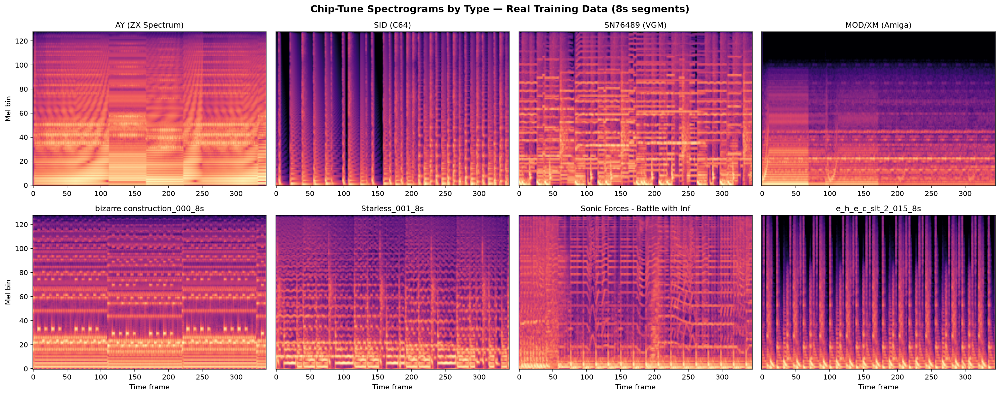

# Chip Types — Four Sound Chips, Four Sonic Signatures

This project trains on music from four different chip-tune sources. Each comes from hardware with distinct constraints, and those constraints show up clearly in spectrograms. Understanding the differences is the foundation for M4's conditional generation — teaching the model to produce output "in the style of" a specific chip.

---

## The four chip types

### AY-3-8910 (ZX Spectrum, Amstrad CPC, MSX)

**Hardware:** 3 square-wave tone channels + 1 noise channel. No filters, no envelopes beyond simple on/off volume control.

**Sound character:** Thin, buzzy, pure. Each channel produces a square wave at a fixed frequency — the simplest waveform there is. With only 3 channels, arrangements are sparse. Composers used rapid arpeggios (cycling through chord notes faster than the ear can track) to fake chords from a single channel.

**Spectrogram signature:** Sharp, evenly-spaced horizontal lines (harmonics of the square wave). Very little energy above the fundamental and first few harmonics. Sparse — lots of dark (silent) regions between the active channels. The arpeggios show as rapid vertical stepping between frequency bands.

**In the dataset:** 1,020 segments from Modland's AY Emul archive (ZX Spectrum game soundtracks).

> **Coming from C:** A square wave is the simplest oscillator you'd build in hardware — flip a bit at a clock-divided rate. The AY is literally three flip-flop counters driving a DAC. No multiply, no accumulator, no filter — just on/off at a frequency.

---

### SID 6581/8580 (Commodore 64)

**Hardware:** 3 oscillators with selectable waveform (triangle, sawtooth, pulse, noise), a resonant multi-mode filter (low-pass, band-pass, high-pass), hardware ADSR envelopes, and ring modulation.

**Sound character:** Warm, thick, bass-heavy. The filter is the defining feature — sweeping the cutoff frequency creates the characteristic "wobble" that makes C64 music instantly recognisable. Sawtooth waves through a low-pass filter produce rich, almost analog-sounding timbres. The ADSR envelopes give notes shape (attack-decay-sustain-release) rather than just on/off.

**Spectrogram signature:** Broad horizontal bands with visible filter sweeps — energy that slides up or down across frequency bins over time. More low-frequency energy than any other chip type. Harmonics are denser (sawtooth waves have all integer harmonics) and blur together through the filter. Less silence between channels — the filter smears energy across the spectrum.

**In the dataset:** 1,827 segments from HVSC (High Voltage SID Collection — the canonical C64 music archive).

> **Coming from JS/TS:** The SID's filter is like a `BiquadFilterNode` in the Web Audio API — same concept (resonant low-pass), different implementation (analog on the SID, digital in WebAudio). The sweeps you see in SID spectrograms are the equivalent of automating `frequency.linearRampToValueAtTime()`.

---

### SN76489 (Sega Master System, Game Gear, Mega Drive)

**Hardware:** 3 square-wave tone channels + 1 noise channel. Similar to the AY in concept but with different clock dividers and a noise generator that can lock to the third tone channel's frequency.

**Sound character:** Bright, punchy, more aggressive than AY. The square waves are similar but the noise channel is more versatile — locking it to tone channel 3 creates metallic timbres used for percussion and sound effects. Sega composers developed a distinctive style that used the noise channel rhythmically.

**Spectrogram signature:** Similar to AY (sharp harmonic lines) but with more energy in the high frequency range. The locked-noise technique shows as broadband bursts aligned with rhythmic patterns. More rhythmic structure visible in the low-frequency region — Sega games tend to have more prominent bass lines.

**In the dataset:** 1,230 segments from archive.org VGM collections (Master System and Game Gear game soundtracks).

---

### MOD/XM (Amiga, PC trackers)

**Hardware:** The Amiga's Paula chip played back 4 channels of 8-bit PCM samples. Later tracker formats (XM, IT) ran in software with more channels and higher bit depth. Unlike the other three, this is sample-based — any sound can be a channel, not just synthesised waveforms.

**Sound character:** Richer and more varied than pure synthesis chips. Instruments are short recorded samples (a piano note, a drum hit, a bass pluck) played back at different pitches. The timbre depends entirely on what samples the composer loaded. Some MODs sound like chip-tunes (using simple waveform samples); others sound closer to real instruments.

**Spectrogram signature:** The most complex spectrograms in the dataset. Multiple simultaneous timbres create overlapping harmonic patterns. Percussion shows as vertical broadband strikes. The energy distribution is more even across the frequency range — no single fundamental dominates the way a square wave does. More variation between tracks than any other chip type (because sample choice is unconstrained).

**In the dataset:** 11,069 segments from The Mod Archive — by far the largest subset. This imbalance is intentional for M4 (see "Why unbalanced" below).

> **Coming from C:** Paula is essentially a DMA engine — it reads sample bytes from RAM at a programmable rate and pushes them to the DAC. No synthesis, no filtering, just memory-to-DAC at variable clock speed. Pitch = playback rate. The CPU sets up the DMA pointers and rates, then Paula runs autonomously until the sample ends.

---

## What the spectrograms show



### Energy distribution (averaged across 20 samples per type)

| Chip type | Low (bins 0–42) | Mid (bins 43–85) | High (bins 86–127) | Character |
|-----------|----------------|------------------|--------------------| ----------|
| AY | −29.8 dB | −37.8 dB | −46.3 dB | Sparse, pure tones |
| SID | −30.3 dB | −40.9 dB | −49.9 dB | Bass-heavy, filtered |
| SN76489 | −26.0 dB | −34.2 dB | −41.3 dB | Bright, even spread |
| MOD/XM | −28.6 dB | −38.8 dB | −46.7 dB | Rich, varied |

Key observations:
- **SN76489 is the loudest** across all bands — Sega soundtracks tend to use all channels at full volume with prominent percussion
- **SID drops off fastest** in the high bins (−49.9 dB) — the low-pass filter literally removes high frequency energy
- **AY and MOD/XM are similar in energy** but look very different — AY's energy is concentrated in narrow harmonic lines while MOD/XM spreads across many overlapping timbres
- The difference between low and high bins ranges from 15–20 dB across all types — enough for a model to learn distinct frequency profiles per chip

### Visual tells

If you're looking at an unlabelled spectrogram and want to guess the chip type:

- **Sharp, thin horizontal lines with lots of silence** → AY or SN76489 (square wave harmonics)
- **Broad smeared bands, especially in the bass** → SID (filter sweeps)
- **Dense overlapping patterns with vertical percussion strikes** → MOD/XM (sample-based)
- **Bright with broadband noise bursts** → SN76489 (locked noise channel)

---

## Why this matters for conditioning (M4)

Class conditioning teaches the model: "when the label says AY, generate spectrograms that look like AY training data — sparse harmonic lines, not filter sweeps."

The visual differences above are the signal the model will learn to distinguish. If AY and SID spectrograms looked identical, conditioning would be useless — there'd be nothing to condition on. But they don't: the energy distribution, harmonic structure, and temporal patterns are all different.

### Why unbalanced data

The dataset is deliberately unbalanced for M4:

| Type | Count | % |
|------|------:|--:|
| AY | 1,020 | 7% |
| SID | 1,827 | 12% |
| SN76489 | 1,230 | 8% |
| MOD/XM | 11,069 | 73% |

In M2d we used balanced data (capped to 1,020 each = 4,080 total) and the model overfitted by epoch 20 on the small dataset. Using all 15,146 samples gives the model 3.7× more data to learn from.

The imbalance means the model sees more MOD/XM than anything else. This is fine:
- **Classifier-free guidance** handles the imbalance at inference — you dial up the guidance scale to push output *toward* the requested chip type regardless of training frequency
- The unconditional baseline (what the model learns as "generic chip-tune") will lean MOD/XM, but that's acceptable — it's the most varied category and a reasonable default
- If AY output quality suffers from underrepresentation, we can oversample in future training runs

---

## The hardware lineage

```
1979  AY-3-8910          ← General Instrument
       │
1982  SID 6581           ← MOS Technology (Commodore)
       │                    (breakthrough: analog filter on a digital chip)
       │
1984  SN76489            ← Texas Instruments
       │                    (AY concept, different noise generator)
       │
1985  Paula              ← Commodore (Amiga)
                            (paradigm shift: samples, not synthesis)
```

The progression mirrors computing itself: from fixed-function hardware (AY: 3 square waves) to programmable hardware (SID: configurable oscillators + filter) to general-purpose sample playback (Paula: any sound, from RAM). Each step trades simplicity for expressiveness, and that shows in the spectrograms.
