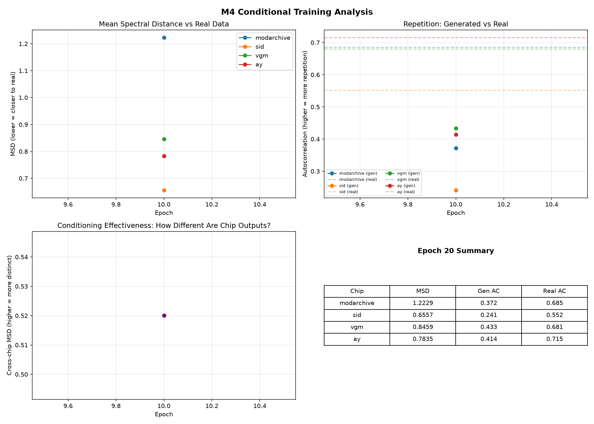

# Classifier-Free Guidance — Steering Generation Without a Separate Classifier

The unconditional model from M2 generates "a chip-tune." But we want to say "generate a chip-tune *in the style of AY*" or "*in the style of SID*." That's conditioning — telling the model what kind of output you want.

Classifier-free guidance (CFG) is how we do it. One model learns both the conditional and unconditional distributions, then at inference time we amplify the difference between them. No separate classifier network needed.

This document explains the technique, how we implemented it in drift, and what we found when we trained with it.

---

## The problem — how do you condition a diffusion model?

The U-Net predicts noise: given a noisy spectrogram and a timestep, it predicts what noise was added. To condition on chip type, we need the model to predict *different* noise depending on which chip we ask for.

The naive approach: train a separate model per chip type. But that wastes parameters (the models would share 95% of what they learn — "how music works") and can't generalise across chips.

The better approach: give the model a class label as an extra input. AY = 0, SID = 1, VGM = 2, modarchive = 3. The model learns to adjust its predictions based on the label.

But just adding a label isn't enough. The model might learn to mostly ignore it — especially early in training when the shared musical structure dominates. That's where guidance comes in.

---

## How it works — three pieces

### 1. Class embedding (in the U-Net)

Same idea as the timestep embedding. The timestep is an integer that gets projected into a high-dimensional vector and added to every layer. We do the same thing with the class label.

```python
# In UNet.__init__:
# +1 for the unconditional token (index num_classes)
self.class_emb = nn.Embedding(num_classes + 1, t_dim)

# In UNet.forward:
if class_label is not None:
    t_emb = t_emb + self.class_emb(class_label)
```

The class embedding is *added* to the time embedding, so every residual block in the U-Net sees both "what timestep is this?" and "what chip type should this be?"

**Coming from C/TS:** Think of it as a lookup table. `class_emb` is an array of 5 vectors (4 chips + 1 unconditional). The class index selects which vector to add into the signal path.

### 2. Label dropout during training (CFG dropout)

Here's the trick. During training, we randomly replace some labels with a special "unconditional" token (index 4 — one past the last real class). With probability 10%, any given sample trains as if it has no label.

```python
# In train_step:
drop_mask = torch.rand(batch_size, device=device) < cfg_dropout  # 10%
labels = torch.where(drop_mask, torch.full_like(labels, num_classes), labels)
```

This means the model learns two things simultaneously:
- **With a real label:** "here's what AY chip-tunes sound like"
- **With the unconditional token:** "here's what chip-tunes sound like in general"

The same model, the same weights, learning both distributions. The unconditional token acts as "I don't care which chip — just make music."

**Coming from C/TS:** It's like training a function that accepts an optional parameter. 90% of the time it gets a specific chip type. 10% of the time it gets `null`, and has to handle the general case. The network learns to branch internally.

### 3. Guided sampling (dual forward pass)

At inference time, we run the model *twice* per denoising step:

1. **Conditional pass:** predict noise given the chip label (e.g. AY)
2. **Unconditional pass:** predict noise with the unconditional token

Then we combine them:

```
noise_guided = noise_unconditional + scale * (noise_conditional - noise_unconditional)
```

The `(noise_conditional - noise_unconditional)` part is the *direction* the chip label pushes the output. The `scale` (guidance scale) controls how hard we push.

```python
# In sampler.generate:
noise_cond = model(x, t, class_label=chip_label)
noise_uncond = model(x, t, class_label=unconditional_token)
noise = noise_uncond + guidance_scale * (noise_cond - noise_uncond)
```

- **Scale 1.0:** no guidance. `noise = noise_conditional`. The label has its natural effect.
- **Scale 3.0:** moderate guidance. Amplifies the chip-specific direction by 3×.
- **Scale 7.0:** strong guidance. Very chip-specific, but can overshoot and distort quality.

**Coming from C/TS:** Think of it as a vector operation. The unconditional prediction is the baseline. The conditional prediction points in the direction of "more AY-like." The guidance scale is a multiplier on that direction vector. Crank it up and you get *extremely* AY-like output — possibly at the cost of realism.

---

## The trade-off — musicality vs. chip identity

We trained for 20 epochs on 15k loop-filtered segments across 4 chip types with CFG dropout of 0.1.

**The model learned "music" at epoch 10.** Autocorrelation (repetition) peaked across all chip types — VGM generated output essentially matched real data (0.536 vs 0.538). The spectrograms showed clear note onsets, frequency bands, phrase structure, and repetition.

But at epoch 10, chip types sounded similar to each other (cross-chip MSD = 0.224). The model prioritised the shared structure — rhythm, pitch, looping — over the per-chip differences.

Guidance scale sweep at epoch 10:

| Scale | Cross-chip MSD | Avg autocorrelation | What it means |
|-------|---------------|---------------------|---------------|
| 1.0 | 0.159 | 0.445 | Musical, chips alike |
| 3.0 | 0.224 | 0.510 | Best balance |
| 5.0 | 0.316 | 0.439 | More distinct, less musical |
| 7.0 | 0.520 | 0.365 | Very distinct, quality drops |

This is the fundamental CFG trade-off, well-documented in the image generation literature. Higher guidance = more adherence to the condition = less diversity and quality. The sweet spot depends on the application.

For drift, guidance scale 3.0 is the default — it produces the most musical output while still responding to the chip label.



---

## Why it works — the geometry

The noise prediction lives in a high-dimensional space (128 × 352 = 45,056 dimensions for an 8s spectrogram). The unconditional prediction sits at the centre of all chip types. Each conditional prediction points slightly toward its chip's characteristic features.

The guidance scale stretches the distance between the centre and the chip-specific direction. At scale 1.0, you're at the natural distance. At scale 5.0, you're 5× further out in the "AY direction."

Low scales: the model generates from near the centre — good quality, but all chips look similar.
High scales: the model generates from far out — very chip-specific, but potentially outside the region of realistic spectrograms.

This is the same reason high-guidance Stable Diffusion images look "overcooked" — saturated, high-contrast, exaggerated features. The output is *more like the prompt*, but less like a real image.

---

## In practice — what this means for the creative workflow

For drift as a sample generator, the guidance scale is a creative knob:

- **Low guidance (1.0–2.0):** "Make me something musical. I don't care which chip it sounds like." Good for exploration.
- **Medium guidance (3.0):** "Make me something musical that leans toward this chip type." The default.
- **High guidance (5.0–7.0):** "I specifically need this to sound like a SID chip." Useful when matching a target, but listen carefully — quality may drop.

The epoch 10 finding — that the model learned shared musical structure before chip-specific identity — suggests that with more per-chip training data or longer training with learning rate scheduling, both goals could be achieved simultaneously. That's a refinement for later.

---

## Implementation summary

| Component | File | What it does |
|-----------|------|-------------|
| Class embedding | `drift/unet.py` | `nn.Embedding(num_classes + 1, t_dim)` added to time embedding |
| CFG dropout | `drift/train.py` | 10% random label replacement with unconditional token |
| Dual forward pass | `drift/sampler.py` | Two predictions combined with guidance scale |
| CLI | `scripts/generate.py` | `--chip ay --guidance-scale 3.0` |
