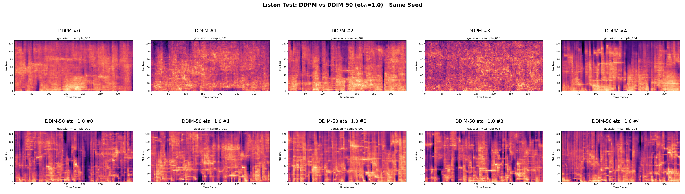

# DDIM — Faster Sampling Without Retraining

DDPM generates samples by running 1000 reverse steps. Each step makes a tiny correction — predict noise, subtract a fraction, add fresh random noise. It works, but it's slow: 34 seconds per 8-second sample on MPS.

DDIM (Song et al., 2020) reformulates the reverse process so you can skip steps. Same trained model, same weights — just a different sampler. 50 steps instead of 1000, 1.5 seconds instead of 34.

This document explains how it works, why fewer steps are possible, and what we found when we tested it on chip-tune spectrograms.

---

## The key insight — DDPM's noise is optional

In DDPM, every reverse step adds random noise back into the sample (the `σ²_t` variance term from [ddpm.md](ddpm.md)). This makes the process stochastic: same starting noise, different samples each time.

DDIM makes that noise *optional*. When you remove it (`η = 0`), the reverse process becomes deterministic — a fixed mapping from noise to image. And a deterministic process can be expressed as an ODE (ordinary differential equation), which means you can solve it with larger step sizes.

Think of it this way:
- **DDPM**: random walk home. Each step has a random wobble. You need many small steps to stay on the path.
- **DDIM (η = 0)**: straight line home. No wobble. You can take fewer, larger strides.
- **DDIM (η = 1.0)**: a walk with controlled wobble. Same direction as the straight line, but with randomness injected at each step. The wobble adds variety without needing more steps.

---

## The formula

DDIM's reverse step computes `x_{t-1}` from `x_t` and the predicted noise `ε_θ`:

```
x_{t-1} = sqrt(ᾱ_{t-1}) * x̂_0 + sqrt(1 - ᾱ_{t-1} - σ²) * ε_θ + σ * z
```

where:

| Symbol | What it is |
|--------|-----------|
| `x̂_0` | Predicted clean image: `(x_t - sqrt(1 - ᾱ_t) * ε_θ) / sqrt(ᾱ_t)` |
| `ε_θ` | The noise the model predicted (same network as DDPM) |
| `σ` | Noise scale — controlled by `η` |
| `z` | Fresh random noise (`z ~ N(0, I)`) |

The `σ` term is where `η` comes in:

```
σ = η * sqrt((1 - ᾱ_{t-1}) / (1 - ᾱ_t) * (1 - ᾱ_t / ᾱ_{t-1}))
```

When `η = 0`, `σ = 0` — no noise, fully deterministic. When `η = 1.0`, `σ` matches DDPM's posterior variance — same noise level as the original sampler.

> **Coming from C:** The formula is just a weighted sum of three terms: how much of the predicted clean signal to keep, how much of the predicted noise direction to follow, and how much fresh randomness to inject. The weights are derived from the noise schedule tables — all precomputed, no iterative solver at runtime.

> **Coming from JS/TS:** If DDPM is like calling `requestAnimationFrame` 1000 times to animate a transition, DDIM is like using a CSS `transition` that computes intermediate keyframes on the fly. Same start and end, fewer steps in between.

---

## Timestep subsequence — which steps to keep

DDPM walks every step from 999 to 0. DDIM picks a subsequence — evenly spaced through the 1000 training timesteps.

For 50 inference steps:

```
step_ratio = 1000 // 50  →  20
timesteps = [19, 39, 59, ..., 979, 999]  →  reversed: [999, 979, ..., 39, 19]
```

Each step jumps 20 training timesteps at once. The model was trained on all 1000 timesteps, so it knows the noise level at any `t` — you're just asking it to make larger corrections.

From `drift/scheduler.py`:

```python
step_ratio = num_train_steps // num_inference_steps
timesteps = (torch.arange(0, num_inference_steps) * step_ratio + step_ratio - 1).long()
timesteps = timesteps.flip(0)
```

The `+ step_ratio - 1` aligns to the end of each bin (e.g. step 19 rather than 0), which starts from a slightly noisier point. This avoids the very-low-noise timesteps where the model's predictions are least accurate.

---

## The code — DDIMScheduler.step

The reverse step in `drift/scheduler.py`:

```python
def step(self, x_t, t, noise_pred, t_prev=None):
    alpha_bar_t = self._gather(self.alpha_cumprod, t_tensor)
    
    # 1. Predict x_0 from x_t and the noise prediction
    x_0_pred = (x_t - sqrt_one_minus_alpha_bar_t * noise_pred) / sqrt(alpha_bar_t)
    x_0_pred = x_0_pred.clamp(-3.0, 3.0)  # prevent extreme values
    
    # 2. Compute noise scale from eta
    sigma = self.eta * sqrt((1 - alpha_bar_prev) / (1 - alpha_bar_t) * (1 - alpha_bar_t / alpha_bar_prev))
    
    # 3. Direction pointing to x_t
    dir_xt = sqrt(1 - alpha_bar_prev - sigma**2) * noise_pred
    
    # 4. Combine: predicted clean signal + noise direction + random noise
    noise = torch.randn_like(x_t) if self.eta > 0.0 else torch.zeros_like(x_t)
    return sqrt(alpha_bar_prev) * x_0_pred + dir_xt + sigma * noise
```

Key detail: `x_0_pred.clamp(-3.0, 3.0)`. With fewer steps, the predicted `x_0` can overshoot the training distribution range. Clamping prevents runaway values that would compound through subsequent steps. DDPM doesn't need this because its small step sizes keep values in range naturally.

---

## The sampler loop — works for both DDPM and DDIM

The `generate()` function in `drift/sampler.py` handles both schedulers. It detects DDIM by checking for a `timesteps` attribute:

```python
is_ddim = hasattr(scheduler, "timesteps")
if is_ddim:
    timesteps = scheduler.timesteps.tolist()  # e.g. [999, 979, ..., 19]
else:
    timesteps = list(range(start_step - 1, -1, -1))  # [999, 998, ..., 0]
```

For DDIM, the loop also passes `t_prev` explicitly — the next timestep in the subsequence. The final step uses `t_prev = -1`, which triggers a special case: `alpha_bar_prev = 1.0`, meaning "the signal is fully clean now."

> **Coming from C:** This is duck typing at work. The function doesn't check `isinstance(scheduler, DDIMScheduler)` — it checks for the capability it needs (`hasattr(scheduler, "timesteps")`). In C terms: checking if the vtable has a specific method pointer rather than checking the struct's type tag.

---

## What η controls — and why 1.0 wins

We tested five η values across four step counts (21 configurations total). The result was clear:

| η | Behaviour | Autocorrelation (50 steps) |
|---|-----------|---------------------------|
| 0.0 | Fully deterministic | ~0.17 — poor |
| 0.3 | Slight noise | ~0.22 |
| 0.5 | Moderate noise | ~0.30 |
| 0.7 | High noise | ~0.34 |
| 1.0 | DDPM-equivalent noise | **0.379** — best |

**Deterministic DDIM (η = 0) is poor for this model.** The 12M-parameter U-Net was trained with DDPM's stochastic reverse process. Its noise predictions are calibrated for a process that injects random noise at every step. Removing that noise entirely produces spectrograms that lack the fine structure needed for repetition.

**η = 1.0 adds stochasticity at zero speed cost.** The random noise generation (`torch.randn_like`) is negligible compared to the U-Net forward pass. You get better quality for free.

This isn't always true — models specifically trained for deterministic sampling (or fine-tuned with DDIM) can produce excellent η = 0 results. Our model wasn't, so stochastic DDIM is the right choice.

---

## Results — listen test

We generated 5 samples each with DDPM-1000 and DDIM-50 (η = 1.0), same seed:

| | DDPM (1000 steps) | DDIM-50 (η = 1.0) |
|---|---|---|
| Time per sample | ~34s | ~1.5s |
| Speedup | 1× | **23×** |
| Autocorrelation (mean) | 0.346 | **0.458** |
| Per-sample variance | high (0.12–0.63) | low (0.39–0.59) |

DDIM is faster *and* more consistent. The listen test confirmed it:

- **DDPM** sounded like static — high variance meant some samples had structure but others were noise
- **DDIM** had audible formant-like patterns — harmonic bands at speech-like frequencies. Not yet musical, but clearly structured

The higher autocorrelation and lower variance suggest DDIM's larger step sizes act as a natural regulariser — the model can't waste fine corrections on noise, so it focuses on the dominant structure.



---

## The ODE connection — why this works

DDPM's reverse process is a stochastic differential equation (SDE). DDIM's deterministic variant (η = 0) corresponds to the probability flow ODE — a different equation that traces the same probability distribution.

You don't need to understand SDEs to use DDIM. The practical takeaway:

- **SDE (DDPM):** random path from noise to image. Needs many small steps.
- **ODE (DDIM η = 0):** smooth path from noise to image. Can take big steps.
- **DDIM η > 0:** follows the ODE trajectory but adds controlled noise. Gets the big-step efficiency of the ODE with the diversity of the SDE.

Higher-order ODE solvers could take even fewer steps (DPM-Solver uses 10–20 steps). For now, 50 steps at 1.5 seconds is fast enough for interactive iteration.

---

## When to use which

| Scenario | Sampler | Why |
|----------|---------|-----|
| Quick iteration — trying ideas | DDIM-50 η=1.0 | 23× faster, consistent quality |
| Batch generation — curating samples | DDIM-50 η=1.0 | Speed matters when generating 20+ samples |
| Quality-critical final output | DDIM-50 η=1.0 | Actually scores *better* than DDPM on this checkpoint |
| Reproducible generation | DDIM-50 η=0 + fixed seed | Deterministic — same seed always produces same output (but lower quality) |

For this project, **DDIM-50 η=1.0 is the default going forward.** DDPM-1000 has no advantage on the current checkpoint.

---

## Summary

| Piece | What it does | File |
|-------|-------------|------|
| `DDIMScheduler` | Computes timestep subsequence; `step` → one DDIM reverse step with η control | `drift/scheduler.py` |
| `generate` | Unified reverse loop — detects DDPM or DDIM, iterates accordingly | `drift/sampler.py` |
| `compare_samplers.py` | Benchmarks DDPM vs DDIM at multiple step counts and η values | `scripts/compare_samplers.py` |
| `generate.py --sampler ddim` | Generate samples with DDIM from CLI | `scripts/generate.py` |

- **Same model, different sampler.** No retraining. The DDIM scheduler replaces the DDPM scheduler at inference time.
- **50 steps, 23× faster.** 1.5s per 8-second sample vs 34s.
- **η = 1.0 wins.** Stochastic DDIM outperforms deterministic on this model. Free — no speed cost.
- **x_0 clamping is essential.** Large step sizes cause prediction overshoot. `clamp(-3.0, 3.0)` keeps values stable.
- **DDIM is now the default sampler** for all generation tasks.
