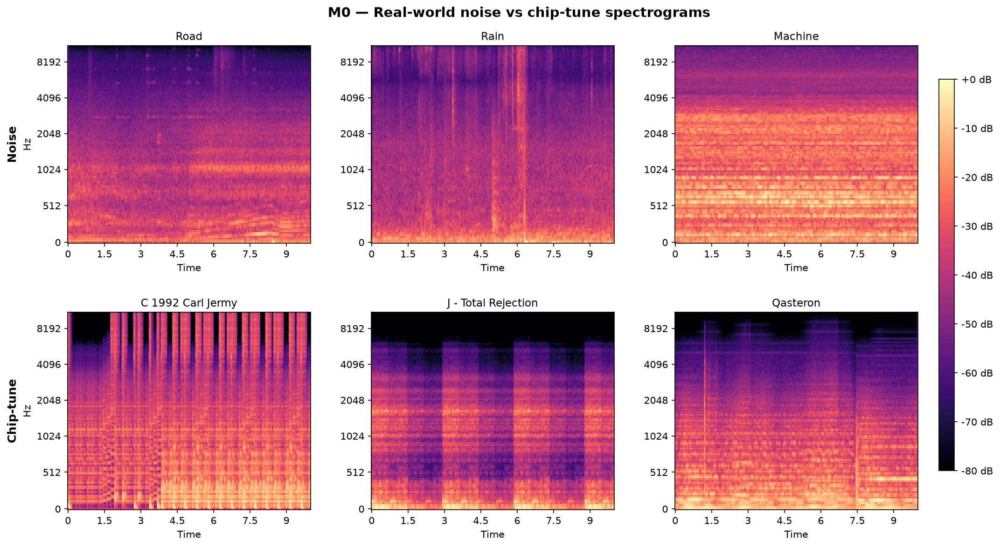

# Natural Noise — Why Real-World Noise Has Structure

Real-world noise isn't random. Road noise, rain, machines — each has a distinctive frequency fingerprint. This matters for diffusion models because the starting noise shapes what the model generates.

---

## Gaussian noise is flat

When we say "random noise" in maths, we usually mean **Gaussian noise** (also called white noise). Every frequency gets the same amount of energy. Low rumble, mid tones, high hiss — all equally loud.

Think of it as static on a detuned TV. No pattern, no rhythm, no structure. Just uniform randomness across the entire spectrum.

In code terms:

```python
# Gaussian noise: every value drawn independently from a normal distribution
noise = np.random.randn(128, 256)  # shape: (frequency_bins, time_steps)
```

Every cell in that array is independent of its neighbours. No correlations. No clusters. No bands.

---

## Real-world noise has shape

Record the world and look at the frequencies. You'll see structure everywhere.

### Road noise

- **Dominated by low frequencies.** Tyres on tarmac produce a deep rumble (50–500 Hz).
- Higher frequencies are quieter — the energy drops off as pitch rises.
- Passing vehicles create **rhythmic swells** — a car approaches, peaks, fades. That's a pattern in time.
- The spectrogram shows a bright band at the bottom (bass) fading to dark at the top (treble).

### Rain

- **Broadband** — energy spread across many frequencies, more so than road noise.
- Individual drops create tiny sharp spikes (transients) — brief bursts of high-frequency energy.
- Heavy rain has a **wash** effect: so many overlapping drops that it approaches white noise, but never quite reaches it.
- Light rain is spikier, more rhythmic. Heavy rain is smoother, more continuous.
- The spectrogram shows a diffuse glow with speckled texture.

### Machine noise

- **Strong harmonics.** A motor spinning at a fixed RPM produces a fundamental frequency plus overtones (2×, 3×, 4× that frequency).
- These show up as **horizontal lines** in a spectrogram — steady pitches held over time.
- Often periodic: the rhythm of a piston, a compressor cycle, a fan blade passing.
- The spectrogram shows clean horizontal bands — almost musical.

### The pattern

| Source | Frequency shape | Time shape |
|--------|----------------|------------|
| Road | Low-heavy, fades upward | Rhythmic swells (vehicles) |
| Rain | Broad, speckled | Random transients, continuous wash |
| Machine | Narrow harmonic lines | Periodic, steady |

None of these look like Gaussian noise. They all have **correlations** — neighbouring frequencies and neighbouring time steps are related to each other.

### The spectrogram comparison



Top row: noise sources. Bottom row: chip-tunes. The difference is immediate.

- **Noise** has diffuse, continuous energy. Road is a bright smear at the bottom (bass). Rain is broadband with vertical burst patterns. Machine has steady horizontal harmonic bands — almost musical already.
- **Chip-tunes** have sharp discrete pitch lines, clean rhythmic gaps (silence between notes), and harmonic stacking (a note plus its overtones as parallel lines). The energy is concentrated, deliberate, structured.

That gap between the two rows is what the diffusion model needs to learn to cross. And when you start from real-world noise instead of Gaussian, you're starting partway across — the structure is already seeded.

---

## Why this matters for diffusion models

A diffusion model learns to reverse noise. During training, you take a clean spectrogram (a chip-tune), gradually add Gaussian noise until it's pure static, and train a neural network to undo each step.

At generation time, you start from noise and denoise step by step. After enough steps, a coherent spectrogram emerges — and you can convert it back to audio.

### The standard approach: start from Gaussian

- Every frequency and time step starts with equal energy.
- The model has total freedom — it can place structure anywhere.
- The output depends entirely on what the model learned during training.

### The drift approach: start from real-world noise

- The starting point already has structure. Road noise has energy concentrated in the bass. Machine noise has harmonic lines.
- The model doesn't start from a blank slate. It starts from a **biased** starting point.
- Low-frequency energy in road noise **nudges** the model toward bass-heavy outputs.
- Harmonic lines in machine noise **nudge** the model toward pitched, tonal outputs.
- The source noise **steers** the generation.

This is the core idea: **different noise sources produce different music**, because the denoising process preserves traces of whatever structure was already there.

When you start denoising from road noise instead of Gaussian, those low-frequency bands are already there. The model doesn't have to invent them — it just has to find the melody in them. That's M5.

---

## Connection to the art project

The Natural Noise art project does the same thing visually, with hand-tuned tools instead of a learned model.

The pipeline in the p5.js code:

1. **Load a photograph** (grass field, sky, etc.)
2. **Convert to greyscale** — `gray = 0.299*R + 0.587*G + 0.114*B` (standard luminance weights)
3. **Apply a sigmoid function** — `f(x) = 1 / (1 + exp(-10 * (x - 0.5)))`. This crushes mid-tones toward black or white, creating sharp boundaries.
4. **Band the values** — `band = int(value * numBands)`. Continuous grey becomes discrete steps.
5. **Map bands to colours** — `colour = band % palette.length`. Each band gets one of 3 colours.

The sigmoid is the key step. It's a **threshold function** — it decides what counts as signal and what gets discarded. Values near 0.5 get pushed to one side or the other. The steepness (10 in the code) controls how aggressive the separation is.

This is hand-tuned denoising:
- The sigmoid separates signal from noise.
- The banding quantises the result into discrete levels.
- The colour map renders the system's interpretation.

A diffusion model does the same thing, but **learns** the separation from data instead of using a fixed sigmoid. The model's training on chip-tune spectrograms is its bias — equivalent to choosing the sigmoid steepness and band count in the art project.

---

## Mel-spectrograms: the shared representation

Both projects work on 2D grids of intensity values. For audio, that grid is a **Mel-spectrogram**.

### What it is

A spectrogram breaks audio into time slices and measures how much energy is at each frequency. The result is a 2D image:
- **Horizontal axis** = time
- **Vertical axis** = frequency
- **Brightness** = energy (louder = brighter)

The "Mel" part means the frequency axis is **log-scaled** to match how humans hear. We're more sensitive to differences between low pitches (100 Hz vs 200 Hz sounds like an octave) than high pitches (10,000 Hz vs 10,100 Hz sounds like nothing). The Mel scale spaces frequencies the way our ears do.

### Why it works

- It's a **2D tensor** — same shape as an image. Any technique that works on images (CNNs, U-Nets, diffusion) works on spectrograms.
- It captures **both** frequency content and time structure. A chord is a vertical pattern. A rhythm is a horizontal pattern.
- The log scale means musical intervals (octaves, fifths) are equally spaced, making it easier for a model to learn musical structure.

### In code

```python
import librosa
import numpy as np

# Load 30 seconds of audio at 22050 Hz
y, sr = librosa.load("road.wav", sr=22050, duration=30)

# Compute Mel-spectrogram: 128 frequency bins, hop length 512 samples
S = librosa.feature.melspectrogram(y=y, sr=sr, n_mels=128, hop_length=512)

# Convert to log scale (decibels) — makes quiet details visible
S_db = librosa.power_to_db(S, ref=np.max)

# S_db is now a 2D array, shape (128, ~1292) — ready for a neural network or a plot
```

> **Coming from C/JS:** Think of it as a 2D bitmap where each pixel's brightness represents "how much energy is at this frequency at this moment." The Mel scale is like using a logarithmic y-axis on a graph — it compresses the top and stretches the bottom.

### The bridge to the art project

A Mel-spectrogram of road noise and a Natural Noise rendering of a grass field are **structurally identical**: 2D arrays of intensity values with spatial correlations. That's why we can feed one into the other (see [natural-noise-to-drift.md](../natural-noise-to-drift.md) for the cross-feed experiments).

---

## Summary

- **Gaussian noise** is flat — equal energy everywhere, no structure.
- **Real-world noise** has shape — frequency biases, temporal patterns, harmonics.
- **Diffusion models** denoise step by step. The starting noise steers the output.
- **Starting from real-world noise** means the source's frequency structure biases the generated music.
- **The art project** did this visually with hand-tuned filters. Drift does it with audio using learned denoising.
- **Mel-spectrograms** are the shared representation — 2D tensors that work for both audio and image-based models.
