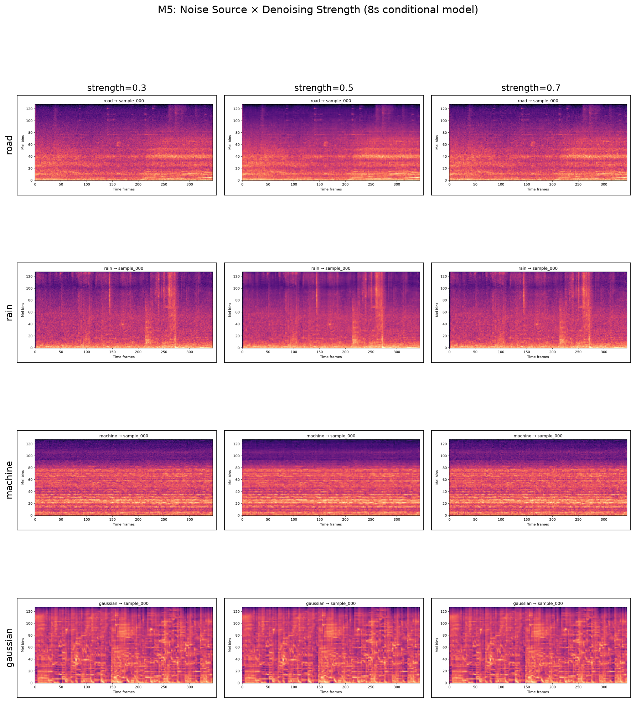
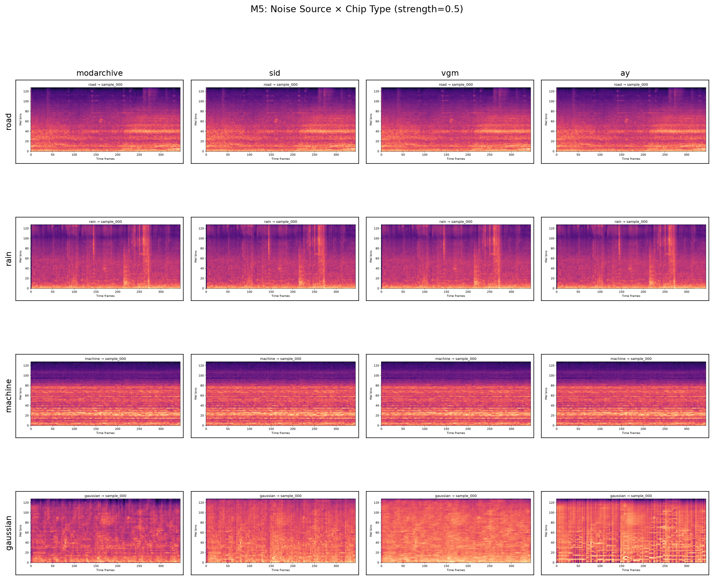

# Non-Gaussian Starting Points — When Noise Has Character

Gaussian noise is the default starting point for diffusion models. It's random, structureless, and forgets everything about where it came from. But what if you start from something that isn't random?

M5 tested three real-world recordings — road traffic, rain, machinery — as diffusion starting points. The results are concrete: the noise source shapes the output in measurable, repeatable ways.

---

## 1. The standard starting point

DDPM and DDIM both start generation from pure Gaussian noise.

Gaussian noise means every pixel (or in our case, every mel-spectrogram bin) is drawn independently from a normal distribution. No correlation between neighbours. No frequency preference. No structure at all.

This is deliberate. The model is trained to map Gaussian noise → real spectrograms. If you start from pure Gaussian noise, the **only** thing shaping the output is what the model learned from training data.

That's fine for generation. But it also means you have no way to steer the output other than the chip-type conditioning signal.

---

## 2. What if the starting noise isn't random?

Real-world recordings aren't Gaussian. They have **spectral structure**:

- Road traffic concentrates energy in the low frequencies (bass rumble, tyre noise)
- Rain spreads energy broadly across the spectrum (broadband white-noise character)
- Machinery has rhythmic periodicity — regular pulses at a fixed tempo

When you convert a recording to a Mel-spectrogram, that structure is visible as a pattern of values across the frequency bins. It isn't random.

If you use that spectrogram as your diffusion starting point instead of Gaussian noise, you're placing the denoising process at a **different location in the data space**. The model still denoises — it still applies everything it learned — but it's starting from a point that already has a frequency bias.

The model can't ignore that bias. It has to work with it.

---

## 3. How partial denoising works with structured noise

The `--strength` parameter controls how far back into the diffusion process you go before denoising. See [partial-denoising.md](partial-denoising.md) for the full mechanism.

The key point here is how strength interacts differently with structured noise vs Gaussian noise:

**With Gaussian noise**, every starting point is equally random. Strength 1.0 gives you a random output every time, with no input signal.

**With structured noise**, the starting spectrogram already has a frequency profile. At **low strength** (0.3), you add only a little diffusion noise — 70% of the structure survives into the denoising phase. The model denoises from a point close to the original recording.

At **high strength** (0.7), you add more noise — the structure is partially buried but not gone. The model denoises from further back, but the surviving frequency bias still pulls the output in a direction.

The noise source never disappears completely. Even at strength 0.7, there are measurable differences between outputs from different noise sources.

### Coming from C

Think of seeding a PRNG. A deterministic seed gives repeatable output. A structured seed — one that encodes meaningful data — gives output that **inherits structure from the seed**.

Gaussian noise is like a hash function: it destroys all input structure and produces uniform randomness regardless of what went in. Structured noise is like passing a real value as the seed — the PRNG output isn't uniform, it's biased toward the seed's character.

### Coming from JS/TS

Think of an image processing pipeline: `input → blur → sharpen → contrast`. If you feed in a photo of a city skyline, every downstream step works on that content. If you feed in white noise, the pipeline has nothing to amplify.

Structured noise is the photo. Gaussian noise is white noise. The model's denoising steps are the pipeline — they operate on whatever you give them.

---

## 4. What M5 found

We ran a full grid: three noise sources × multiple strength levels × four chip types. Here are the concrete numbers — and, critically, what they sound like.

### The honest listen test

**Strengths 0.3–0.7 sound like noise, not music.** The metrics below show real spectrogram-level differences at every strength, but ears don't lie. At partial strengths the model doesn't get enough denoising steps to push the output into musical territory. The recording's noise character dominates.

**Strength 1.0 is the sweet spot.** At full denoise, the model treats the recording's spectrogram as its starting tensor (instead of Gaussian noise) and runs all 50 DDIM steps. The recording's spectral structure — bass distribution, periodicity — seeds the generation differently. The output sounds like music with character inherited from the source.

This is the key insight: the partial-denoising approach from M2c (4s model) doesn't scale to the 8s model. The quality sweet spot is full denoise with a structured seed, not halfway denoising.

### Noise sources produce different outputs

**Cross-source MSD: 0.24–0.26** at all tested strengths.

Change the noise source but keep everything else the same — the outputs differ by a consistent, measurable margin. This holds across the full strength range. The noise source isn't interchangeable.

### Some sources steer harder than Gaussian

We compared each noise source to a Gaussian baseline (same strength, random noise start):

| Source | MSD vs Gaussian |
|--------|----------------|
| Rain   | 0.85           |
| Road   | 0.72           |
| Machine| 0.54           |

Rain steers the most. Its broadband frequency profile is very different from Gaussian — the model receives a strong frequency bias and the output reflects it. Machine steers the least — its spectral profile happens to be closer to what Gaussian noise produces after some diffusion steps.

### The model preserves the frequency profile

**Frequency correlation: 0.98–0.99** between noise source frequency profile and output frequency profile.

The model doesn't erase the noise source's frequency character — it preserves it almost perfectly. If your noise source has strong bass, the output has strong bass. This is not a coincidence or an artifact: the model learned to denoise, not to flatten.

### Road traffic makes repetitive loops

**Autocorrelation scores:**

| Source   | Autocorrelation |
|----------|----------------|
| Road     | 0.85           |
| Rain     | 0.53           |
| Machine  | 0.25           |
| Gaussian | 0.30           |

Road traffic has natural low-frequency periodicity. The model sees that periodicity, can't eliminate it, and amplifies it into musical repetition. Road-seeded outputs are highly loopable. Rain-seeded outputs have moderate repetition. Machine-seeded outputs are barely more repetitive than Gaussian.

This is the most practically useful finding. If you want loops, start from road noise.

### Chip conditioning weakens with noise starts

**Cross-chip MSD with noise starts: 0.01–0.02**
**Cross-chip MSD with Gaussian: 0.08**

When you use structured noise as the starting point, the noise source dominates chip identity. The model's chip-type conditioning signal is weaker relative to the input frequency bias. The four chip types become harder to tell apart in the output.

This is a trade-off. Noise starts give you more creative steering but less chip-type control. Gaussian starts give you full chip-type control but no input steering.


*Each row is a noise source. Each column is a strength level. Visible: bass concentration (road), broadband brightness (rain), rhythmic patterning (machine).*


*Each row is a noise source. Each column is a chip type. Visible: chip identity becomes harder to distinguish as noise source influence dominates.*

---

## 5. Why this matters

Different noise sources are **creative tools**, not interchangeable randomness.

- **Road noise** → bass-heavy, highly repetitive loops. The low-frequency bias + natural periodicity combine into something that sits well in a mix as a rhythm element.
- **Rain** → broadband, varied textures. High frequency energy, low repetition. Better for atmosphere than rhythm.
- **Machine** → rhythmic but less structured. The periodicity is there, but not as pronounced as road traffic. Middle ground between road and rain.

The practical implication: the recording location is a **creative parameter**. You choose the noise source the way you choose a sample pack — for its sonic character, not its randomness.

### In practice

In a music production workflow, this changes how you work:

> Record in a factory → industrial-sounding loops with mechanical rhythm  
> Record near a road → bass-heavy beats with natural repetition  
> Record in rain → bright, ambient textures with no dominant pitch  

The noise source doesn't need to sound musical. It needs to have the **spectral character** you want to inherit.

---

## 6. Connection to the art project

The Natural Noise visual art project found the same principle: photographs of real-world textures (concrete, bark, rust) steered the visual output of diffusion generation. The texture's spatial structure seeded the generation — areas of high frequency detail in the photo produced high-frequency detail in the output.

This is the same mechanism in a different sensory domain. The spectral structure of a sound recording is analogous to the spatial structure of a photograph. Both are 2D arrays. Both carry structure that the model preserves.

**M7 (Eyes and Ears)** will explore this directly — using images as diffusion seeds for audio generation. If a photograph of a city skyline has similar spatial-frequency structure to road traffic noise, it should produce similar audio outputs.

**M8 (Cross-feed)** goes further: using images as starting points, measuring how the visual content of the image influences the sonic character of the output. Non-Gaussian starting points revisited, but across sensory modalities.

---

## Running the experiment

```bash
# Full grid (3 sources × 5 strengths × 2 chip types)
python scripts/experiment_m5.py

# Single generation with a noise source
python scripts/generate.py \
    --checkpoint _data/checkpoints/epoch_0010.pt \
    --from-noise _data/noise/road.wav \
    --strength 0.5 \
    --chip-type sid \
    --n 4

# Analysis
python scripts/analyse_m5.py
```
