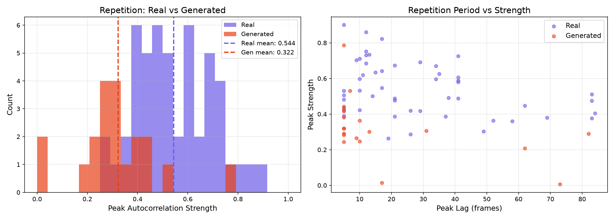
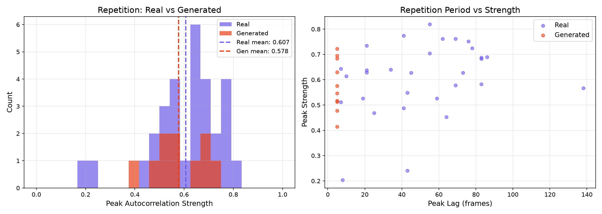

# Repetition and Autocorrelation

Chip-tunes loop. A 4-bar phrase repeats as the verse, another as the chorus. This repetition is what makes them catchy — and teaching the model to reproduce it required rethinking the training data, not the architecture.

## Measuring repetition with autocorrelation

Autocorrelation asks: "how similar is this signal to a time-shifted copy of itself?" For a spectrogram, we average across Mel bins to get a 1D energy signal along the time axis, then check how well it correlates with itself at different lags.

```python
signal = spec.mean(dim=0)  # average across frequency → 1D time signal
signal = signal - signal.mean()

for lag in range(min_lag, n // 2):
    correlation = (signal[:n - lag] * signal[lag:]).sum() / norm
```

A strong peak at lag 20 means the spectrogram repeats every 20 frames (~0.5s at our hop length). Real chip-tunes show peaks because they loop; random noise shows nothing.

### Coming from C

Autocorrelation is essentially a sliding dot product — the same operation as convolution with yourself. If you've implemented an FIR filter, you've done this: multiply-accumulate at each offset. The normalisation (dividing by the signal's energy) just puts it on a 0–1 scale. The FFT-accelerated version (`detect_loop_fft` in `drift/loops.py`) uses the Wiener–Khinchin theorem: autocorrelation equals `IFFT(|FFT(x)|²)`, turning an O(n²) loop into O(n log n).

### Coming from JS/TS

Think of it like checking if a CSS animation loops smoothly. You'd compare frame 0 to frame N, frame 1 to frame N+1, etc. If the animation repeats every 60 frames, the comparison at offset 60 would show a near-perfect match. That's autocorrelation — measuring the "loop point."

## The experiments

### Experiment 1: 4s baseline (failed)



| | Mean peak strength | Median |
|---|---|---|
| **Real chip-tunes** | 0.544 | 0.520 |
| **Generated (4s, epoch 50)** | 0.322 | 0.304 |
| **Gap** | 0.222 | 0.216 |

The model learned temporal structure (onsets, frequency banding) but not looping. **Why?** A typical chip-tune loop at 120 BPM is 4–8 bars = 8–16 seconds. A 4-second training window often cuts a loop in half. The model never sees the same phrase twice, so it can't learn that repetition is a feature of the data.

### Experiment 2: More self-attention (failed)

Added self-attention at U-Net level 2 (32×44 resolution), +4.4% params. After 10 epochs: autocorrelation 0.23 vs baseline 0.25 at the same epoch — no improvement. Attention wasn't the bottleneck.

### Experiment 3: 8s window + loop filter + bigger model (success)

The fix was **data, not architecture:**

1. **Loop detection** — built `drift/loops.py` with FFT-accelerated autocorrelation on raw waveforms. Scanned 31k 8s segments: 15k have detectable loops (confidence > 0.3), all with loop period < 4s — meaning 2+ full repeats fit in the 8s window.

2. **Bigger model** — bumped base_ch from 32 to 64 (3M → 12M params) because the input is 2x wider (352 frames vs 176).

3. **Trained 50 epochs** in 5-epoch chunks with listening tests at each checkpoint.



| Model | Autocorrelation | Gap from real |
|-------|----------------|--------------|
| Real (8s loops) | 0.607 | — |
| **8s loop model, epoch 20** | **0.578** | **0.029** |
| 8s loop model, epoch 40 | 0.365 | 0.251 |
| 4s baseline, epoch 50 | 0.322 | 0.222 |

**Epoch 20 nearly matched real chip-tunes on repetition.** The gap shrank from 0.222 (4s baseline) to 0.029 — a 87% improvement.

### Why epoch 20, not epoch 40?

The model overfitted. Training on a balanced dataset of 3,264 samples (1,020 per chip type), the model memorised the average by epoch 40 instead of preserving the detail it had learned by epoch 20. Listening confirmed: epoch 20 had audible rhythmic structure; epoch 40 sounded like static.

This is a textbook overfitting pattern on small datasets — the model passes through a "sweet spot" where it's learned enough to be useful but hasn't yet collapsed to the mean.

### In practice

This is the same problem as training a recommendation engine on too little data. Early in training, the model picks up genuine patterns (users who buy X also buy Y). Later, with insufficient data diversity, it starts memorising individual users instead of generalising. The fix is always the same: more data, or stop earlier. In ML, "early stopping" is a regularisation technique — you monitor a validation metric and stop training when it starts degrading.

## The lesson: data windowing matters more than architecture

We tried three levers for repetition:
1. More self-attention → didn't help
2. Longer context (8s) → helped, but only because...
3. Loop-filtered training data → the actual fix

The model couldn't learn repetition from 4s windows because repetition literally wasn't in the data at that scale. No architecture can learn a pattern it never sees. The loop detector (`drift/loops.py`) filters training data to segments that contain at least 2 full repeats — giving the model something to learn from.

## Running the analysis

```bash
# Compare real vs generated repetition (4s baseline)
python scripts/analyse_repetition.py --n-real 50 --n-gen 20

# Filter 8s segments to loops only
python scripts/filter_loops.py --min-confidence 0.3

# Compare with 8s loop model
python scripts/analyse_repetition.py \
  --data _data/segments_loops --duration 8 \
  --checkpoint _data/checkpoints_8s_loops/epoch_0020.pt \
  --n-real 50 --n-gen 20

# Loop detection on a single wav
python -c "
from drift.loops import detect_loop_fft
import librosa
wav, sr = librosa.load('path/to/file.wav', sr=22050)
_, period, confidence = detect_loop_fft(wav, sr)
print(f'Loop period: {period/sr:.2f}s, confidence: {confidence:.3f}')
"
```
