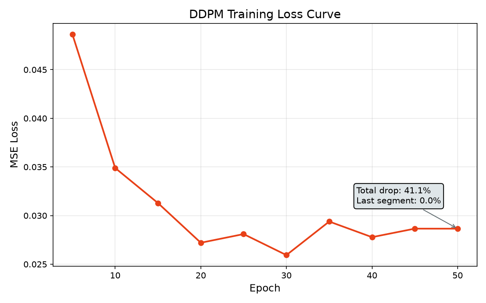
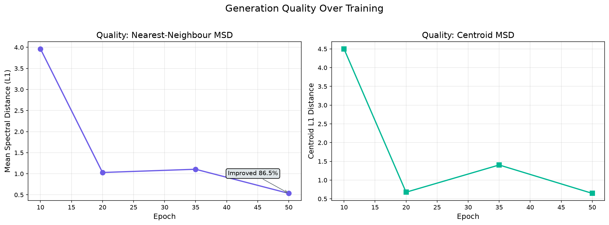

# Training Loss Curves and Quality Metrics

How do you know if a diffusion model is actually learning? Two complementary measurements: the **loss curve** (is the model getting better at predicting noise?) and a **quality metric** (are the generated spectrograms getting closer to real ones?).

## The loss curve

During training, the model sees a real spectrogram with noise added at a random timestep, and tries to predict what noise was added. The error — mean squared error (MSE) between predicted and actual noise — is the training loss.

Plotting this over epochs shows the learning trajectory:



**What the curve tells us:**

- **Steep decline (epochs 5–20):** The model is rapidly learning the basic structure of chip-tune spectrograms — frequency bands, onset patterns, silence vs activity.
- **Plateau (epochs 25–50):** Loss hovers around 0.028. The model has learned what it can learn at this capacity. More epochs won't help — the bottleneck is now the model architecture (size, attention mechanism, conditioning).

### Coming from C

Think of loss as an error metric in a feedback loop. If you're writing a PID controller, the loss is the error term — the gap between where you are and where you want to be. A plateaued loss means your proportional gain can't close the remaining error; you need a different control strategy.

### Coming from JS/TS

Think of it like optimising a web app's Lighthouse score. Early wins are big (lazy loading, code splitting), then you hit diminishing returns. At that point, throwing more of the same optimisation at it won't help — you need a different approach (SSR, edge caching). Same here: the model needs architectural changes, not more epochs.

## Mean spectral distance (MSD)

Loss tells you the model is learning to predict noise, but not whether the *generated output* looks like real spectrograms. For that, we compare generated samples directly against the training distribution.

**How it works:**

1. Load 100 real spectrograms from the training set
2. Generate 5 spectrograms from a checkpoint
3. For each generated sample, find its nearest real sample (by L1 distance)
4. Average those minimum distances

```python
def mean_spectral_distance(real, generated):
    real_flat = real.reshape(real.shape[0], -1)
    gen_flat = generated.reshape(generated.shape[0], -1)

    min_distances = []
    for g in gen_flat:
        dists = (real_flat - g.unsqueeze(0)).abs().mean(dim=1)
        min_distances.append(dists.min().item())

    return sum(min_distances) / len(min_distances)
```

**Why nearest-neighbour, not average?** If the model generates diverse outputs (some SID-like, some AY-like), we don't want to penalise it for not matching every real sample — only that each generated sample is close to *some* real sample. This rewards both quality and diversity.



**Results:**

| Epoch | MSD (nearest) | Centroid MSD |
|-------|---------------|-------------|
| 10    | 3.96          | 4.50        |
| 20    | 1.03          | 0.68        |
| 35    | 1.11          | 1.40        |
| 50    | 0.53          | 0.65        |

**86.5% improvement** from epoch 10 to 50. Unlike the loss curve, the quality metric is still improving at epoch 50 — the model is getting better at generating realistic spectrograms even though its noise prediction loss has plateaued.

### Why do loss and quality diverge?

Loss measures average noise prediction across all 1000 timesteps. The model might plateau on hard timesteps (mid-range, where noise and signal are mixed) while continuing to improve on the timesteps that matter most for generation quality (the final denoising steps, where fine detail emerges).

### Coming from C

MSD is conceptually similar to a Hamming distance — how different are two bitstreams? Here it's pixel-level L1 distance across the Mel bins. The nearest-neighbour twist is like doing a fuzzy string match: "is this generated string close to *any* string in my dictionary?" rather than "is it close to the average string?"

### Coming from JS/TS

Think of it like comparing two screenshots pixel-by-pixel (visual regression testing). MSD is the average pixel difference between a generated screenshot and its closest match in the reference set. Lower means the generated output looks more like something real.

## What this means for the project

For the GO/NO-GO gate (M2 exploration):

- **Criterion #2** (loss still dropping): Partially met. Loss has plateaued, but this is expected for a small U-Net. A bigger model or attention at more resolutions would likely push it lower.
- **Criterion #3** (quality metric shows improvement trend): **Met.** MSD improved 86.5% and is still trending down at epoch 50.

The takeaway: the diffusion approach is working. The model is learning real structure, not just memorising noise statistics. Architectural improvements (more attention, conditioning, larger model) are the path to better quality — not more training epochs on the current architecture.

## Running the evaluations

```bash
# Loss curve (subsampled — ~5 min)
python scripts/evaluate_loss.py --max-batches 200

# Quality metric (generates samples — ~40 min)
python scripts/evaluate_quality.py --epochs 10,20,35,50 --n-samples 5
```

Both save JSON results to `_data/eval/` and plots to `docs/images/`.
