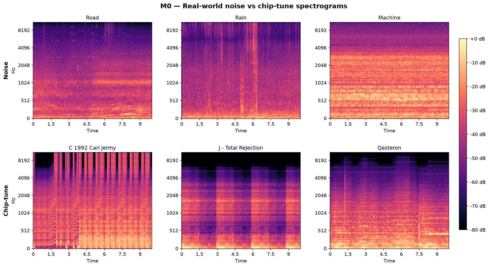
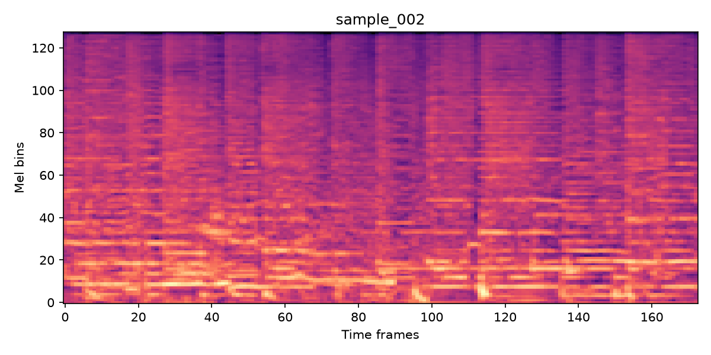

<!-- _class: title-slide -->
<!-- _paginate: false -->

# Drift

**Generating chip-tune music from noise using diffusion models**

A research project exploring audio generation, spectrogram processing, and creative AI.

---

## What is Drift?

Drift generates **chip-tune music** — the sound of retro game consoles — by training a diffusion model on thousands of real chip-tune spectrograms.

The model starts with pure random noise and gradually removes it, step by step, until a playable melody remains. The same technique behind image generators like Stable Diffusion, applied to audio.

**Why chip-tunes?** Simple waveforms. Small dataset. Fast iteration. A constrained domain where you can hear whether the model is learning — and explain every step.

---

## Noise — randomness with a purpose

Noise sounds like static, but it has structure. The kind of randomness determines the character of the sound — and in Drift, it's the raw material the model learns to sculpt.

- **White noise** — every frequency equally loud. Pure hiss. A PRNG (pseudo-random number generator) toggling a speaker bit produces this — it's how Beepers makes percussion.
- **Pink noise** — lower frequencies are louder. Sounds warmer, like rain or a waterfall. Closer to how energy is distributed in real music.
- **Gaussian noise** — values drawn from a bell curve. This is what Drift's diffusion model starts from — a mathematically well-behaved noise that the model learns to remove step by step.

The key insight: noise isn't the absence of signal. It's a *starting point*. Drift's M0 milestone showed that even natural noise (road traffic, rain) has learnable frequency patterns — the model can use that structure to steer what it generates.

In Beepers, noise is an effect. In Drift, noise is the canvas.

---

## How it works — the 30-second version

**1. Collect** — Download thousands of chip-tune files from public archives (SID, VGM, MOD formats). Render them to audio.

**2. Slice** — Cut into 4-second segments. Convert each to a Mel-spectrogram — a visual heatmap of frequencies over time.

**3. Train** — Take a real spectrogram, add random noise to it, then ask a neural network called a U-Net (named for its shape — it compresses the image down then expands it back up) to predict what noise was added. Repeat millions of times. The network learns the difference between signal and noise.

**4. Generate** — Start from pure noise. The trained network removes a tiny amount of noise, 1,000 times. What's left is a new spectrogram. Convert back to audio.

*Each step has a plain-language explainer doc for follow-up reading.*

---

## Why audio? What this has to do with financial data.

A Mel-spectrogram is a 2D grid: **frequency x time**. A financial dataset is the same shape: **features x time** — price, volume, volatility, flows, all varying over a time axis.

The techniques are identical:

| Audio domain | Financial domain |
|---|---|
| Denoise a spectrogram to reveal pitch structure | Denoise a price series to reveal trend and regime |
| Generate new spectrograms from noise | Generate synthetic scenarios for stress testing |
| Condition on chip type ("make it sound like SID") | Condition on asset class or market regime |
| Start from a real recording instead of random noise | Start from real market conditions instead of assumptions |

Chip-tunes are a safe, fast, audible sandbox. You can *hear* when the model gets it wrong. Financial time series are high-stakes and slow to validate — so we develop the intuition here first, then transfer.

**The goal is not music. The goal is learning diffusion on structured signals in a domain where mistakes are obvious.**

---

## What we've built so far

| Milestone | Status | What it proved |
|-----------|--------|----------------|
| **M0 — Natural noise baseline** | Done | Real-world noise (road, rain) has learnable frequency structure — not random |
| **M1 — Spectrogram dataset** | Done | 54,000 segments across 4 chip types, balanced and ready for training |
| **M2 — DDPM baseline** | Done | Generates pitch structure and onsets from pure noise. Not yet musical — M5 uses real-world noise. |

---

## M0 — Real noise has structure

Before building the model, we asked: *is there actually structure in noise?*

Road noise, rain, machinery — they look random. But their spectrograms reveal patterns: road noise concentrates in low frequencies, rain is broadband, machines have harmonic peaks.

This matters because Drift's endgame (M5) will start from real-world recordings instead of random noise — using the structure in a field recording to steer the generated melody.

*→ Explainer: [natural-noise.md](explainers/natural-noise.md)*

---

## M0 — Spectrograms compared

---

## M1 — Building the dataset

54,000 spectrogram segments from 4 chip architectures:

| Chip | Source | Character |
|------|--------|-----------|
| **SID** (C64) | HVSC archive | Warm, melodic, filter sweeps |
| **AY** (ZX Spectrum) | Modland | Bright, buzzy, fast arpeggios |
| **SN76489** (Mega Drive) | archive.org | Clean square waves, punchy |
| **MOD/XM** (Amiga) | Mod Archive | Rich samples, complex patterns |

Each segment: 4 seconds of audio, rendered as a 128 x 173 Mel-spectrogram, normalised to [-1, 1].

Balanced across chip types so the model doesn't overfit to one sound.

*→ Explainers: [diffusion-models.md](explainers/diffusion-models.md), [noise-schedules.md](explainers/noise-schedules.md)*

---

## M2 — Training the diffusion model (DDPM)

DDPM — **Denoising Diffusion Probabilistic Model** — the foundational algorithm for this family of generative models.

A U-Net denoising network trained on the full 54k-segment dataset. 50 epochs, ~18 hours on Apple Silicon (MPS).

The model starts from **pure random noise** — no audio, no signal — and denoises it step by step into a spectrogram. This is a mathematical starting point (Gaussian noise), not a natural one. M5 will replace this with real-world recordings.

**What the model learned to generate from nothing:**

- Note attacks and silence gaps (vertical dark lines)
- Frequency banding that resembles chip-tune harmonics
- Phrasing — quiet sections between active passages
- Variety — each sample is different, not collapsed to one output

**What it hasn't captured yet:**

- Sharp harmonic ladders (real chip-tunes have razor-crisp overtones)
- Looping and repetition (a defining feature of chip music)

*→ Explainers: [ddpm.md](explainers/ddpm.md), [libraries.md](explainers/libraries.md), [python-concepts.md](explainers/python-concepts.md)*

---

## M2 — Generated from noise (epoch 50)

This spectrogram was generated entirely from random noise. Compare with the real training data on the next slide — the macro structure (onsets, banding, energy distribution) is recognisable. The fine detail (harmonic precision, repetition) is where more training and architectural improvements will close the gap.

---

## What's next

| Milestone | What it will prove |
|-----------|--------------------|
| **M3 — DDIM sampling** | Generate in 50 steps instead of 1,000 — 20x faster, same quality (Denoising Diffusion Implicit Models) |
| **M4 — Conditional generation** | "Generate a SID-style tune" vs "Generate an AY-style tune" — steer the output |
| **M5 — Real-world noise seeds** | Start from a road recording instead of random noise — the noise shapes the melody |
| **M6 — CLI + demo** | `python -m drift generate --from-noise road.wav` — one command, playable output |
| **M7-M8 — Eyes and ears** | Photograph a place + record its sound. Generate art and music from the same moment. |

---

## The bigger picture

Drift is a **diffusion model applied to audio spectrograms**. The techniques transfer directly.

| Drift concept | Transfers to |
|---------------|-------------|
| Spectrogram denoising | Any 2D signal — financial time series, sensor data, medical imaging |
| U-Net architecture | Standard backbone for image segmentation, anomaly detection |
| Noise scheduling | Controls quality/speed tradeoff in any generative model |
| Conditional generation (M4) | Steer output by category — product type, client segment, risk profile |
| Non-Gaussian starting points (M5) | Use real data as seed instead of random — domain-specific priors |

The constrained domain (chip-tunes) makes every concept audible and visual.
Hard to hide mistakes when you can *hear* them.

---

<!-- _class: title-slide -->
<!-- _paginate: false -->

# Drift

**Generating chip-tune music from noise**

Explainer docs for follow-up reading:
[natural-noise](explainers/natural-noise.md) | [diffusion-models](explainers/diffusion-models.md) | [noise-schedules](explainers/noise-schedules.md) | [ddpm](explainers/ddpm.md)
