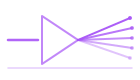

<!-- _class: title-slide -->
<!-- _paginate: false -->



# Prism

**Cross-modal learning — audio to visual through shared latent spaces**

A VAE that learns what melodies look like, inspired by chromesthesia.

---

## What this will be

A study of representation learning — training a Variational Autoencoder (VAE) to compress melodies into a meaningful latent space, then mapping that space to visual parameters.

The name comes from a prism splitting light — here we split audio through a visual lens.

| Component | Detail |
|-----------|--------|
| **Architecture** | VAE encoder/decoder on melody sequences |
| **Latent space** | Learned compression — similar melodies cluster together |
| **Cross-modal head** | Maps latent vectors to colour, energy, motion |
| **Data** | Labelled melody JSONs with 7 semantic dimensions |
| **Inspiration** | Chromesthesia — hearing colour, seeing sound |

---

## Why a VAE?

A Variational Autoencoder learns to compress data into a smooth, continuous space. Unlike a plain autoencoder, the VAE's latent space is *structured* — you can walk between points and get meaningful interpolations.

- **Encode** — a melody goes in, a compact latent vector comes out
- **Decode** — a latent vector goes in, a melody comes out
- **Interpolate** — blend two melodies smoothly by moving between their vectors
- **Sample** — pick a random point in latent space, decode a new melody

This is the foundation for cross-modal mapping: if the latent space captures musical meaning (mood, energy, rhythm), a second network can learn to translate that meaning into visual parameters.

---

## The cross-modal bridge

The same melody triggers both sound and colour in chromesthesia. Prism builds that bridge computationally.

```
Melody → VAE encoder → latent vector → cross-modal head → visual params
  notes, rhythm           z ∈ ℝ^d         colour, energy,
  tempo, mood                              motion, texture
```

- **Shared representation** — one vector captures the essence of a melody
- **Multiple outputs** — the same vector drives audio reconstruction AND visual generation
- **Grounded in perception** — labels come from human descriptions (mood, imagery, character)

The key insight: if two melodies feel similar to a listener, their latent vectors should be close — and their visual mappings should look similar too.

---

## How it connects

Four related projects exploring sound from different angles.

```
Beepers              Signal Hunt           Chant                 Drift
───────              ───────────           ─────                 ─────
Build the signals    Classify them         Describe → generate   Generate from noise

                              Prism
                              ─────
                     See them — melody ↔ visual
```

- **Signal Hunt** provides the classification backbone — verifying what Prism generates
- **Drift** shares the spectrogram foundation — 2D representations of audio
- **Chant** provides text-conditioned sequences — Prism adds visual conditioning
- **Beepers** generates the source audio that Prism learns to see

---

## The audio-to-finance bridge

Latent spaces and cross-modal mapping transfer directly to financial domains.

| Prism concept | Financial application |
|---------------|---------------------|
| VAE on sequences | Learn "normal" transaction patterns, flag anomalies as high reconstruction error |
| Latent space clustering | Customer segmentation across products, channels, behaviours |
| Cross-modal mapping | Shared embeddings between text (reports, filings) and numbers (positions, risk) |
| Smooth interpolation | Generate synthetic but realistic data for GDPR-safe testing |
| Representation learning | Discover hidden structure in complex multi-dimensional data |

Learn it on melodies where you can hear and see the results. Apply it to data where the stakes are higher.

---

## Status

This project is in the planning and data preparation phase.

| Done | What |
|------|------|
| ✓ | Chromesthesia research and inspiration docs |
| ✓ | Melody schema design (pitch, duration, 7 semantic dimensions) |
| ✓ | Sample melodies with full labels |
| | VAE architecture and training |
| | Latent space exploration and visualisation |
| | Cross-modal head (latent → visual) |
| | Interactive demo — play a melody, see its colour |

*The hard part isn't the neural network. It's designing a representation that captures what music means — not just what it sounds like.*
